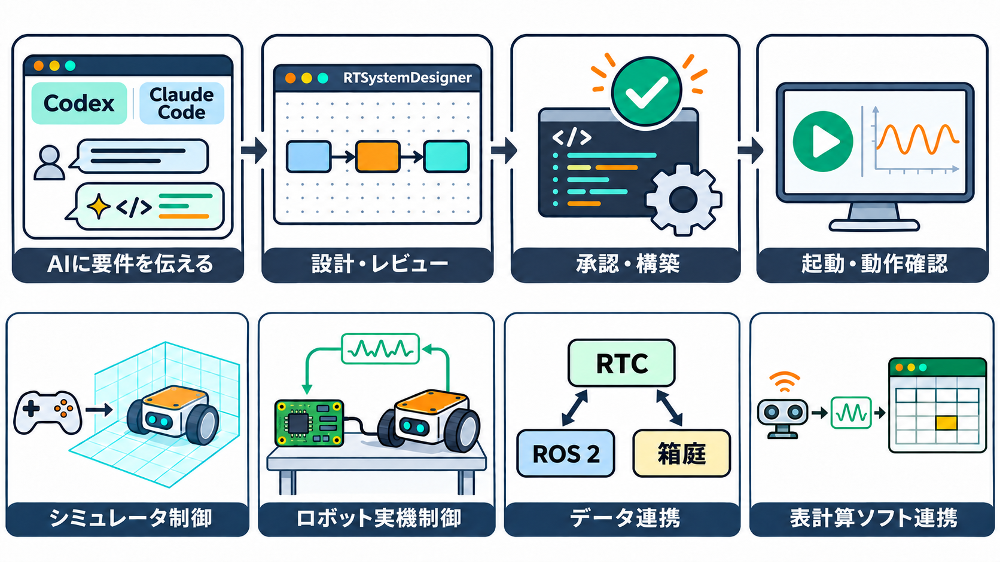

# RTC-Agent-Tools

[English](README.md)

RTC-Agent-Tools は、Codex などのエージェントと一緒にロボットシステムを設計・構築・実行するためのツール群です。エージェントに作りたいシステムを伝えると、設計案を RTSystemDesigner で確認できます。設計を確定した後は、その内容に沿って構築と起動を依頼できます。[公開版 RTSystemDesigner](https://nobu19800.github.io/RTSystemDesigner/)

## できること

Codex や Claude Code に作りたいシステムを伝えると、エージェントがカタログから既存の RTC、ROS 2 ノード、箱庭アセットを選び、設計案を作成します。RTSystemDesigner で設計を確認し、確定したら、足りない RTC の生成やシステムの構築・起動をエージェントに依頼できます。たとえば、ジョイスティックでシミュレーター上のロボットを操作したり、Windows と Raspberry Pi に配置した RTC 間でデータを送ったりできます。LibreOffice Calc と接続すれば、RTC が出力した値をセルに書き込み、セルの値を別の RTC へ渡せます。

上段は、要件を伝え、RTSystemDesigner で設計を確認し、承認後に構築・起動する手順です。下段は、移動ロボットのシミュレーション、実機制御、RTC・ROS 2・箱庭のデータ連携、表計算ソフトとの連携の概念図です。実機制御には、対象機器に対応したコンポーネントと接続設定が必要です。

最初の例は [クイックスタート](docs/quickstart.md) で試せます。通信や表計算ソフトとの連携は、下の事例を参照してください。

## すぐに試す

[クイックスタート](docs/quickstart.md) では、GUI ジョイスティックで物理シミュレータ上の移動ロボットを操作します。クローンから設計確認、起動、終了まで、Codex と Claude Code のどちらでも使える5つのメッセージを掲載しています。

Codex で作業フォルダを開くか、そのフォルダの端末で Claude Code を起動します。どちらでも同じメッセージから始めることができます。

> この作業フォルダに https://github.com/Nobu19800/RTC-Agent-Tools.git をクローンして。

## ドキュメント

| ドキュメント | 内容 |
| --- | --- |
| [クイックスタート](docs/quickstart.md) | Codex または Claude Code でサンプルシステムを構築し、画面で動作を確認する |
| [環境構築手順書](docs/setup.md) | 実行環境と依存ツールを準備する |
| [動作マニュアル](docs/operation-manual.md) | 設計、構築、起動、停止の操作手順を確認する |
| [詳細な動作仕様書](docs/operation-specification.md) | 設計情報、カタログ、構築・実行時の処理を確認する |
| [ローカル版 RTSystemDesigner の連携手順](docs/local-designer.md) | ローカルの Designer とセッションサーバーを使う |
| [RTC–箱庭アセット連携手順](docs/rtc-hakoniwa.md) | RTC の DataPort と箱庭 PDU を接続し、値を照合する |
| [RTC–ROS 2 連携手順](docs/rtc-ros2.md) | TkJoyStick RTC で Turtlesim を操作する |
| [表計算ソフトと連携するシステム構築事例](docs/calccontrol-example.md) | LibreOffice Calc を経由して ConsoleIn と ConsoleOut を接続する |
| [Windows と Raspberry Pi に RTC を分散配置する手順](docs/windows-raspberry-pi.md) | 各マシンの名前サービスを使い、マシン間で整数を送る |
| [空のセッションから設計する](docs/empty-session.md) | RTSystemDesigner で構成を作り、エージェントに渡す |
| [RTSystemDesigner のモジュール設定項目](docs/designer-module-settings.md) | RTC、ROS 2 ノード、箱庭アセットの設定項目を確認する |
| [OpenRTM-aist の型変換と通信プラグイン](docs/rtc-transport-plugins.md) | 箱庭・ROS 2 連携で使うプラグインの役割と設定を確認する |
| [カタログと XML プロファイル](docs/catalog-profiles.md) | 各カタログ、ISO 22166-202 対応 XML、RTC.xml の内容を確認する |
| [AGENTS.md](AGENTS.md) | エージェント向けの作業指示と、日英の作業ガイドへの入口 |
| [Python の静的解析と単体テスト](docs/drone-adapter-checks.md) | Bandit・flake8・pytest の実行手順と測定結果 |
| [C++ の静的解析と単体テスト](docs/drone-adapter-cpp-checks.md) | Clang・GoogleTest・LLVM カバレッジと箱庭での確認結果 |
| [Lua の静的解析と単体テスト](docs/lua-rtc-checks.md) | Luacheck・LuaUnit・LuaCov と Windows／WSL2 の RTC 間通信 |
| [箱庭転送の検証記録](docs/validation/hakoniwa-transport-2026-10-30.md) | 箱庭 PDU 転送の検証条件と結果 |
| [箱庭外部接続の検証記録](docs/validation/external-hakoniwa-connections-2026-10-30.md) | 箱庭アセットと外部モジュールの接続検証 |
| [カタログの生成と検索](catalog/README.md) | 収集・再生成・検索のコマンド |
| [OpenRTM サンプルプロファイル](profiles/openrtm-samples/README.md) | 収録対象とサンプルカタログの生成元 |
| [ROS 2 ノードの XML プロファイル](profiles/iso22166-202/ros2/README.md) | ROS 2 プロファイルの収録範囲と出典 |
| [箱庭ドローンの XML プロファイル](profiles/iso22166-202/drone-three-point/README.md) | ドローン構成と PDU の対応 |
| [ROS2Transport の往復テスト](examples/ros2-transport/README.md) | Python／C++ で文字列の往復通信を検証する |
| [箱庭転送の実装例](examples/hakoniwa_transport/README.md) | Python の転送プラグインと PDU の検証手順 |

### エージェント向け作業ガイド

| ガイド | 内容 |
| --- | --- |
| [作業ガイド索引](docs/agents/ja/README.md) | 日英の作業指示の入口 |
| [サービス](docs/agents/ja/services.md) | セッション API とカタログ取得 |
| [設計](docs/agents/ja/design.md) | 候補選定と設計確定 |
| [セッション形式](docs/agents/ja/session-format.md) | 設計 JSON の構造 |
| [作業領域](docs/agents/ja/workspace.md) | 承認済み設計の取得と配置 |
| [生成](docs/agents/ja/generation.md) | RTC プロファイルとソースの生成 |
| [実装](docs/agents/ja/implementation.md) | 実装とビルドの規則 |
| [検証](docs/agents/ja/verification.md) | 動作確認とログ |
| [実行](docs/agents/ja/runtime.md) | 起動・接続・停止 |
| [環境確認](docs/agents/ja/environment.md) | 依存関係とツール確認 |
| [実行環境の導入](docs/agents/ja/install-runtime.md) | ランタイムのインストール手順 |
| [モジュール検査](docs/agents/ja/module-checks.md) | 静的解析・単体テストの実行条件 |
| [OpenRTM サンプル](docs/agents/ja/openrtm-samples.md) | 既存サンプルの選択と起動 |
| [動的 RTC ポート](docs/agents/ja/dynamic-rtc-ports.md) | 接続相手からポートを生成する RTC の扱い |
| [ROS 2](docs/agents/ja/ros2.md) | ノードの選定と実行 |
| [ROS2Transport](docs/agents/ja/ros2-transport.md) | RTC と ROS 2 の接続設定 |
| [箱庭のシリアライザ](docs/agents/ja/hakoniwa-serializer.md) | RTC 型と箱庭 PDU の変換 |
| [箱庭と ROS 2](docs/agents/ja/hakoniwa-ros2.md) | PDU ブリッジとビューアの構成 |
