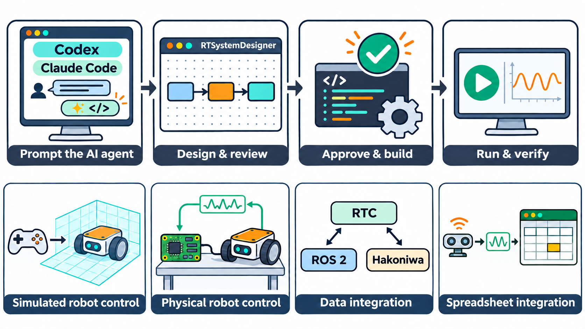

# RTC-Agent-Tools

[日本語](README.ja.md)

The documentation is available on GitHub Pages in [English](https://nobu19800.github.io/RTC-Agent-Tools/) and [Japanese](https://nobu19800.github.io/RTC-Agent-Tools/README.ja.html).

RTC-Agent-Tools helps you design, build, and run robot systems with a coding agent such as Codex. Describe the system you want, review the proposal in RTSystemDesigner, then ask the agent to build and start the approved design. [Public RTSystemDesigner](https://nobu19800.github.io/RTSystemDesigner/)

## What you can do

Describe the system you want to build to Codex or Claude Code. The agent selects existing RTCs, ROS 2 nodes, and Hakoniwa assets from the catalogs and proposes a design. Review it in RTSystemDesigner, then ask the agent to generate any missing RTCs and build and start the system. For example, you can drive a simulated robot with a joystick or exchange data between RTCs running on Windows and Raspberry Pi. With LibreOffice Calc, one RTC can write its output to a cell and another can read the value.

The top row shows how to describe the system, review it in RTSystemDesigner, then build and run it after approval. The bottom row illustrates simulated mobile robot control, physical robot control, data exchange with ROS 2 and Hakoniwa, and spreadsheet integration. Physical robot control requires components and connection settings for the target hardware.

Try the joystick example in the [quickstart](docs/en/quickstart.md). See the integration guides below for the communication and spreadsheet examples.

## Try it

The [quickstart](docs/en/quickstart.md) walks through five messages you can send to either Codex or Claude Code to clone the repository, review the design, build and start a simulated mobile robot, drive it with a GUI joystick, and shut it down.

Open a working folder in Codex or start Claude Code from a terminal in that folder. Send the same first message in either agent.

> Clone https://github.com/Nobu19800/RTC-Agent-Tools.git into this working folder.

## Documentation

| Document | What it covers |
| --- | --- |
| [Quickstart](docs/en/quickstart.md) | Build and try the joystick-controlled simulator |
| [Environment setup](docs/en/setup.md) | Prepare runtimes and dependencies |
| [Operation manual](docs/en/operation-manual.md) | Design, build, start, verify, and stop systems |
| [Detailed operating specification](docs/en/operation-specification.md) | Session data, catalogs, and build and runtime behavior |
| [Local RTSystemDesigner integration](docs/en/local-designer.md) | Run the Designer and session server locally |
| [RTC–Hakoniwa asset integration](docs/en/rtc-hakoniwa.md) | Connect an RTC DataPort to a native Hakoniwa PDU and verify the values |
| [RTC–ROS 2 integration](docs/en/rtc-ros2.md) | Control Turtlesim with the TkJoyStick RTC |
| [Build a system that integrates with a spreadsheet](docs/en/calccontrol-example.md) | Connect ConsoleIn and ConsoleOut through LibreOffice Calc |
| [Deploy RTCs across Windows and Raspberry Pi](docs/en/windows-raspberry-pi.md) | Send an integer between machines using a NameService on each host |
| [Start from an empty session](docs/en/empty-session.md) | Design the system yourself in RTSystemDesigner and hand it to the agent |
| [RTSystemDesigner module settings](docs/en/designer-module-settings.md) | Look up settings for RTCs, ROS 2 nodes, and Hakoniwa assets |
| [OpenRTM-aist serialization and transport plugins](docs/en/rtc-transport-plugins.md) | Understand and configure the plugins for Hakoniwa and ROS 2 |
| [Catalogs and XML profiles](docs/en/catalog-profiles.md) | Explore the four catalogs, ISO 22166-202 mappings, and RTC.xml |
| [AGENTS.md](AGENTS.md) | Repository instructions for agents and links to the language-specific guides |
| [Development inventory](docs/en/development-inventory.md) | Catalogs, generation and runtime tools, integration examples, and documentation |
| [Python static analysis and unit tests](docs/en/drone-adapter-checks.md) | Run Bandit, flake8, and pytest on the drone adapter |
| [C++ static analysis and unit tests](docs/en/drone-adapter-cpp-checks.md) | Run Clang, GoogleTest, and LLVM coverage and review simulator test results |
| [Lua static analysis and unit tests](docs/en/lua-rtc-checks.md) | Run Luacheck, LuaUnit, and LuaCov and verify RTC communication on Windows and WSL2 |
| [Hakoniwa transport validation](docs/validation/hakoniwa-transport-2026-10-30.md) | Review the PDU transport checks and results |
| [External Hakoniwa connection validation](docs/validation/external-hakoniwa-connections-2026-10-30.md) | Review checks of connections between Hakoniwa assets and external modules |
| [Catalog generation and search](catalog/README.md) | Collect, rebuild, and search catalogs |
| [OpenRTM sample profiles](profiles/openrtm-samples/README.md) | Review the sample inventory and catalog inputs |
| [ROS 2 XML profiles](profiles/iso22166-202/ros2/README.md) | Review node coverage and upstream sources |
| [Hakoniwa drone XML profiles](profiles/iso22166-202/drone-three-point/README.md) | Review the drone composition and PDU mappings |
| [ROS2Transport round-trip test](examples/ros2-transport/README.md) | Verify round-trip data transfer with Python or C++ |
| [Hakoniwa transport example](examples/hakoniwa_transport/README.md) | Use the Python transport plugin and verify native PDUs |

### Agent instructions

| Guide | What it covers |
| --- | --- |
| [Agent guide index](docs/agents/en/README.md) | Find the language-specific instructions |
| [Services](docs/agents/en/services.md) | Session API and catalog access |
| [Design](docs/agents/en/design.md) | Select modules and approve a design |
| [Session format](docs/agents/en/session-format.md) | Review the design JSON schema |
| [Workspace](docs/agents/en/workspace.md) | Load the approved design and prepare the workspace |
| [Generation](docs/agents/en/generation.md) | Generate RTC profiles and source skeletons |
| [Implementation](docs/agents/en/implementation.md) | Implement and build modules |
| [Verification](docs/agents/en/verification.md) | Verify behavior and collect logs |
| [Runtime](docs/agents/en/runtime.md) | Start, connect, and stop components |
| [Environment checks](docs/agents/en/environment.md) | Check toolchains and dependencies |
| [Runtime installation](docs/agents/en/install-runtime.md) | Install the runtimes |
| [Module checks](docs/agents/en/module-checks.md) | Run requested analysis and unit tests |
| [OpenRTM samples](docs/agents/en/openrtm-samples.md) | Select and launch existing samples |
| [Dynamic RTC ports](docs/agents/en/dynamic-rtc-ports.md) | Handle RTCs that derive ports from peers |
| [ROS 2](docs/agents/en/ros2.md) | Select and run ROS 2 nodes |
| [ROS2Transport](docs/agents/en/ros2-transport.md) | Configure RTC-to-ROS 2 transport |
| [Hakoniwa serializers](docs/agents/en/hakoniwa-serializer.md) | Map RTC types to Hakoniwa PDUs |
| [Hakoniwa–ROS 2](docs/agents/en/hakoniwa-ros2.md) | Configure the PDU bridge and viewer |

## License

The project's original materials are available under [GNU LGPL 2.1](LICENSE). See [licensing information](LICENSING.md) for scope and upstream materials.
