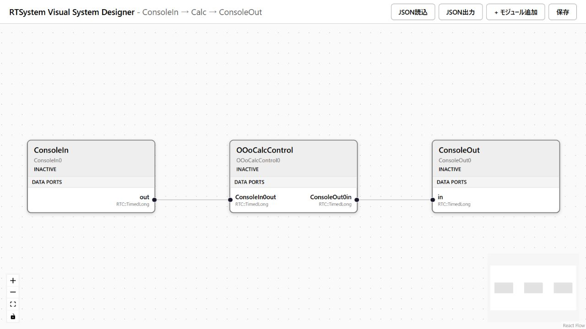

# CalcControl を使ったシステム構築事例

[English](en/calccontrol-example.md)

ConsoleIn に入力した整数を LibreOffice Calc のセルに書き込み、その値を ConsoleOut に送る。Calc 側は OOoRTCs の `OOoCalcRTC.py`（`OOoCalcControl`）から起動する。`CalcControl.py` はその共通クラスである。[動的 RTC ポートの作業手順](agents/ja/dynamic-rtc-ports.md)

## 1. 設計する

RTC-Agent-Tools を配置した作業フォルダのチャットで、エージェントに AGENTS.md に従うよう伝えておく。

> ConsoleIn の整数を Calc の Sheet1!B1 に上書きし、ConsoleOut に送る構成を設計して。

RTSystemDesigner で `ConsoleIn → OOoCalcControl → ConsoleOut` の順に接続する。ConsoleIn と ConsoleOut の実装は、整数型 `RTC::TimedLong` の対応ポートを持つ版を選ぶ。Calc 側の動的ポートは設計時に予定ポートとして表示し、**Implementation → Requirements** に次の設定を記載する。

| 接続 | Calc 側のポート方向 | セルの設定 |
| --- | --- | --- |
| ConsoleIn の OutPort → Calc | InPort | `Sheet1!B1` に書き込む。受信ごとに上書き。移動なし |
| Calc → ConsoleOut の InPort | OutPort | `Sheet1!B1` を読み出して送信。移動なし |

### 登録した構成例

3 つとも既存 RTC を使用する。`OOoCalcControl0` の入出力ポートは実行時に作成し、両方を `Sheet1!B1` に割り当てる。

## 2. 構築して起動する

1. 「設計完了」と伝える。エージェントは LibreOffice、Python UNO と OpenRTM-aist Python が同じ実行環境で使えることを確認し、対象文書と名前サービスを準備する。
2. 「システムを起動して」と伝える。エージェントは相手 RTC を同じ名前サービスに登録してから、選定した版で利用できる経路で Calc のポートを作る。画面からの設定が必要な場合は、案内されたポートとセルを利用者が指定する。
3. ポートの公開名・方向・型と接続を確認する。Calc の自動接続で作成済みの接続は再利用する。

## 3. セルと出力を確認して終了する

ConsoleIn に `21` を入力し、Calc の `Sheet1!B1` と ConsoleOut に `21` が表示されることを確認する。次に `42` を送り、同じセルが上書きされ、ConsoleOut に `42` が届くことを確認する。セルを移動する別構成では、開始セル、移動方向・幅・きっかけを Requirements に追記し、入出力の順序も確認する。確認後、「システムを終了して」と伝える。
