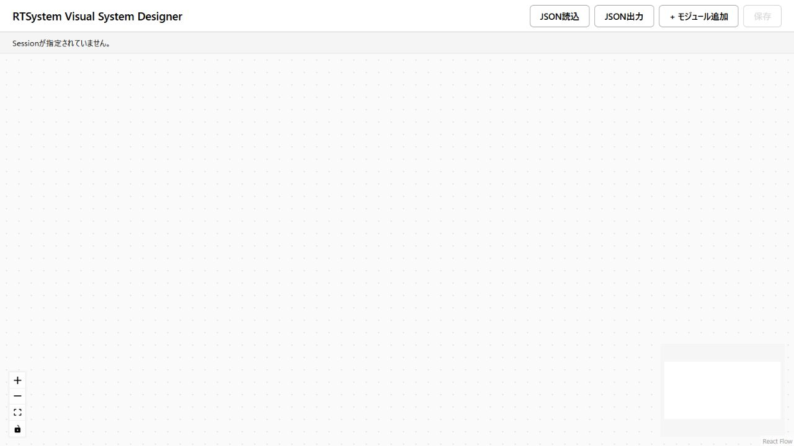
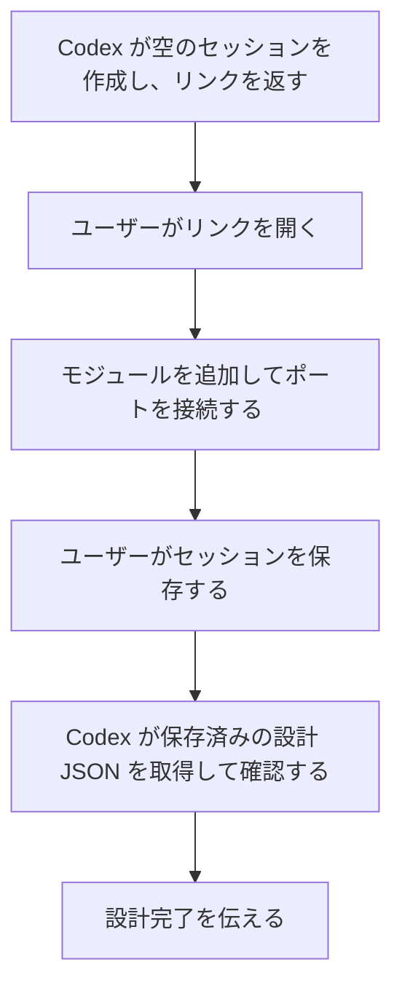

# 空のセッションから設計する

[English](en/empty-session.md)

利用者が RTSystemDesigner で構成を作り、完成した設計をエージェントに渡します。エージェントの設計案から始める場合は [クイックスタート](quickstart.md) を使います。

## 1. 空のキャンバスを開く

リンクで共有できる設計を作る場合は、Codex または Claude Code に次のように依頼します。

RTC-Agent-Tools を配置した作業フォルダのチャットで、エージェントに AGENTS.md に従うよう伝えておきます。

> RTSystemDesigner で空の設計セッションを作って、リンクを見せて。

返されたリンクを開き、何も配置されていないことを確認します。公開版では設計を公開セッションサービスに送るため、機密情報を含めないでください。ローカル連携を使う場合は登録から取得まで同じセッションサーバーを使用します。[ローカル連携手順](local-designer.md)

JSON ファイルで渡す場合は、セッション登録を省略して [公開版 RTSystemDesigner](https://nobu19800.github.io/RTSystemDesigner/) を直接開きます。

以下は Designer を直接開いたときの空のキャンバスです。登録済みのセッションを開いた場合は **保存** が有効になります。

## 2. モジュールと接続を追加する

1. **＋ モジュール追加** を開きます。既存モジュールは **カタログ読込（RTC・OpenRTM サンプル・箱庭・ROS 2）** を選び、**モジュール種別** で RTC・ROS 2 ノード・箱庭アセットを選び、検索欄で名前を絞り込んで追加します。新規モジュールはダイアログ内の **＋ モジュール追加** で作り、`Module Kind` を指定します。新規モジュールには必要なポートを追加します。
2. キャンバス上のモジュールをクリックし、`General` で名前を、`Ports` で型と方向を、`Implementation → Requirements` で実装・実行時の要求を記入します。同じシステム内でインスタンス名を重複させないでください。
3. データ接続は送信側から受信側へ、サービス接続は利用側と提供側を結びます。ROS 2 のトピック名や箱庭の PDU チャンネルなど、図だけで表せない実行時の対応は Requirements に記録します。[モジュール設定項目](designer-module-settings.md)

### 作成例　新規 RTC で整数を2倍にする

既存の `ConsoleIn` に入力した整数を、新規の `DoubleInteger` で2倍にし、既存の `ConsoleOut` に表示する構成です。

1. **モジュール追加** でカタログを読み込み、**モジュール種別 → RTC** を選びます。OpenRTM サンプルの `ConsoleIn` と `ConsoleOut` の Python 版を追加し、インスタンス名を `ConsoleIn0`、`ConsoleOut0` にします。
2. モジュール選択ダイアログ内の **＋ モジュール追加** で新規モジュールを作ります。キャンバスで選択し、次の項目を設定します。

| タブ | 設定値 |
| --- | --- |
| **General** | Module Kind は **RTC**、Module Name は `DoubleInteger`、Instance Name は `DoubleInteger0` |
| **General → Basic Profile** | Generation Language は **Python**。Version は `1.0.0`、Category は `Converter`、Vendor は作成者名を指定 |
| **Ports** | **＋ InPort** で `in`、**＋ OutPort** で `out` を作成。両方の Data Type は `RTC::TimedLong` |
| **Activity** | `onExecute` の **Generate** を **ON** に変更。`onInitialize` は既定の **ON** を使用 |
| **Implementation → Summary** | 整数を2倍にして出力する RTC |
| **Implementation → Requirements** | `in` に新しい値が届いたら1件読み取り、値を2倍にして入力の時刻とともに `out` から送信します。新しい入力がなければ送信しません。結果が符号付き32ビット整数の範囲外なら送信せず、ログに記録します。 |

3. `ConsoleIn0.out → DoubleInteger0.in` と `DoubleInteger0.out → ConsoleOut0.in` を、出力側のハンドルから入力側へドラッグして接続します。2本とも `RTC::TimedLong` です。

~~~mermaid
flowchart LR
    input["ConsoleIn0 既存 RTC"] -->|"out → in · RTC::TimedLong"| doubler["DoubleInteger0 新規 RTC · 2倍"]
    doubler -->|"out → in · RTC::TimedLong"| output["ConsoleOut0 既存 RTC"]
~~~

次の手順で保存してエージェントに渡すと、設計確定後に新規 RTC を生成・実装します。起動後は ConsoleIn に `21` を入力し、ConsoleOut に `42` が表示されることを確認します。

## 3. 保存して渡す

登録済みセッションで作業している場合は **保存** を押し、同じチャットでセッション URL または ID を伝えます。**保存** で設計 JSON がセッションサーバーに保存されます。Codex はそのセッションから JSON を取得します。

ファイルで渡す場合は、別操作の **JSON出力** を押してローカルにダウンロードし、添付します。

> この設計を読み込んで確認して。

エージェントの確認結果を見て、必要なら設計を修正して保存し直します。

> 設計完了

構築結果を確認し、実行する場合は次のメッセージを送ります。

> システムを起動して
