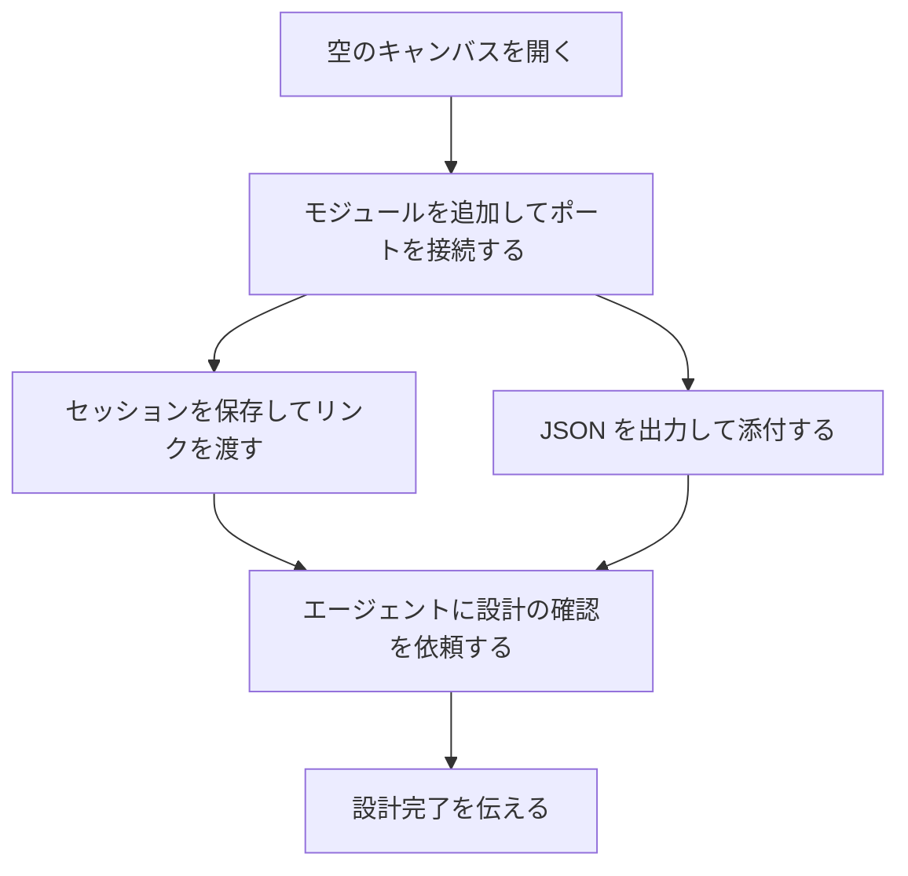

# 空のセッションから設計する

[English](en/empty-session.md)

利用者が RTSystemDesigner で構成を作り、完成した設計をエージェントに渡す。エージェントの設計案から始める場合は [クイックスタート](quickstart.md) を使う。

## 1. 空のキャンバスを開く

リンクで共有できる設計を作る場合は、Codex または Claude Code に次のように依頼する。

RTC-Agent-Tools を配置した作業フォルダのチャットで、エージェントに AGENTS.md に従うよう伝えておく。

> RTSystemDesigner で空の設計セッションを作って、リンクを見せて。

返されたリンクを開き、何も配置されていないことを確認する。公開版では設計を公開セッションサービスに送るため、機密情報を含めない。ローカル連携を使う場合は登録から取得まで同じセッションサーバーを使用する。[ローカル連携手順](local-designer.md)

JSON ファイルで渡す場合は、セッション登録を省略して [公開版 RTSystemDesigner](https://nobu19800.github.io/RTSystemDesigner/) を直接開く。

以下は Designer を直接開いたときの空のキャンバスである。登録済みのセッションを開いた場合は **保存** が有効になる。

## 2. モジュールと接続を追加する

1. **＋ モジュール追加** を開く。既存モジュールは **カタログ読込（RTC・OpenRTM サンプル・箱庭・ROS 2）** を選び、検索欄で候補を絞り込んで追加する。新規モジュールはダイアログ内の **＋ モジュール追加** で作り、`Module Kind` を指定する。新規モジュールには必要なポートを追加する。
2. キャンバス上のモジュールをクリックし、`General` で名前を、`Ports` で型と方向を、`Implementation → Requirements` で実装・実行時の要求を記入する。同じシステム内でインスタンス名を重複させない。
3. データ接続は送信側から受信側へ、サービス接続は利用側と提供側を結ぶ。ROS 2 のトピック名や箱庭の PDU チャンネルなど、図だけで表せない実行時の対応は Requirements に記録する。[モジュール設定項目](designer-module-settings.md)

## 3. 保存して渡す

登録済みセッションで作業している場合は **保存** を押し、同じチャットでセッション URL または ID を伝える。ファイルで渡す場合は **JSON出力** を押し、出力した v2 JSON を添付する。

> この設計を読み込んで確認して。

エージェントの確認結果を見て、必要なら設計を修正して保存し直す。構成が確定したら「設計完了」と伝える。構築結果を確認してから、実行する場合は「システムを起動して」と伝える。
