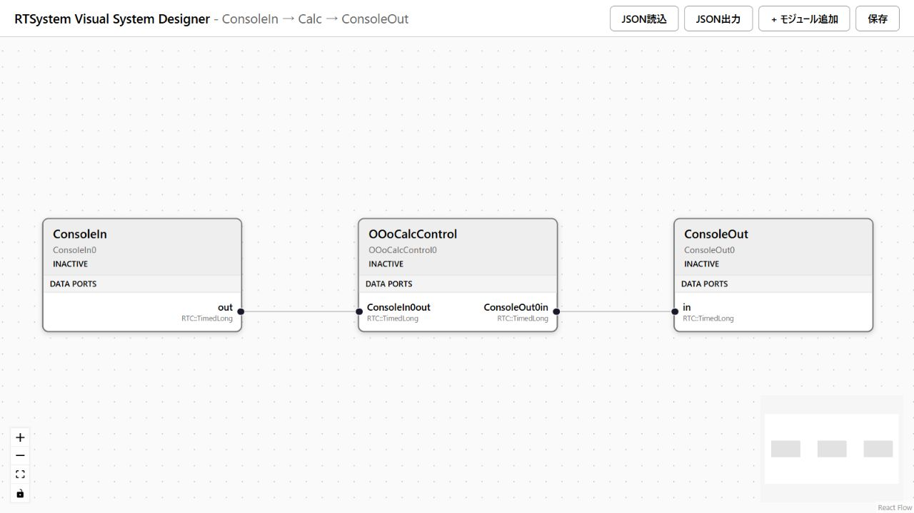
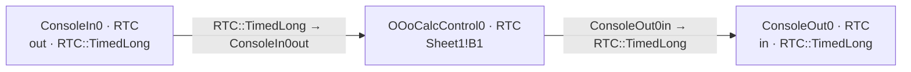

# Build a System with CalcControl

[日本語](../calccontrol-example.md)

Enter an integer in ConsoleIn, write it to a LibreOffice Calc cell, and send the cell value to ConsoleOut. Start the OOoRTCs component through `OOoCalcRTC.py` (`OOoCalcControl`). `CalcControl.py` provides its shared base class. [Dynamic RTC port workflow](../agents/en/dynamic-rtc-ports.md)

## 1. Design the system

Use a chat working in the RTC-Agent-Tools checkout and ask the agent to follow its AGENTS.md.

> Design a system that writes ConsoleIn integers to Calc cell Sheet1!B1 and sends them to ConsoleOut.

In RTSystemDesigner, connect `ConsoleIn → OOoCalcControl → ConsoleOut`. Select ConsoleIn and ConsoleOut implementations whose selected ports use `RTC::TimedLong`. Display the Calc ports as planned dynamic ports and record their cell settings in **Implementation → Requirements**.

| Connection | Calc port direction | Cell behavior |
| --- | --- | --- |
| ConsoleIn OutPort → Calc | InPort | Write to `Sheet1!B1`, overwrite on each input, no cell advancement |
| Calc → ConsoleOut InPort | OutPort | Read and send `Sheet1!B1`, no cell advancement |

### Registered example configuration

All three modules reuse existing RTC implementations. `OOoCalcControl0` creates both ports at runtime and maps them to `Sheet1!B1`.

## 2. Build and start

1. Send “Design approved.” The agent checks that LibreOffice, Python UNO, and OpenRTM-aist Python work together in the selected environment and prepares the document and naming service.
2. Send “Start the system.” The agent registers the peer RTCs with the same naming service before creating the Calc ports through the path supported by the selected version. If configuration requires GUI interaction, follow the agent's instructions to select the ports and cells.
3. Check the live port names, directions, types, and connections. Reuse connectors already created by Calc's automatic connection feature.

## 3. Check the cell and output, then stop

Enter `21` into ConsoleIn and check that both `Sheet1!B1` and ConsoleOut show `21`. Send `42` and check that the same cell is overwritten and ConsoleOut receives `42`. For a configuration that advances cells, record the start cell, direction, increment, and trigger in Requirements, then verify input and output order. Send “Stop the system” when finished.
