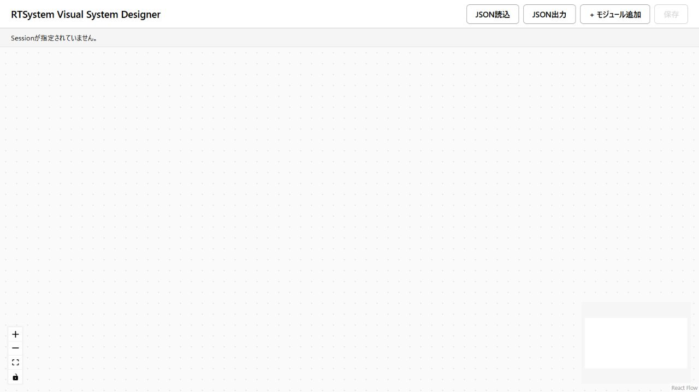
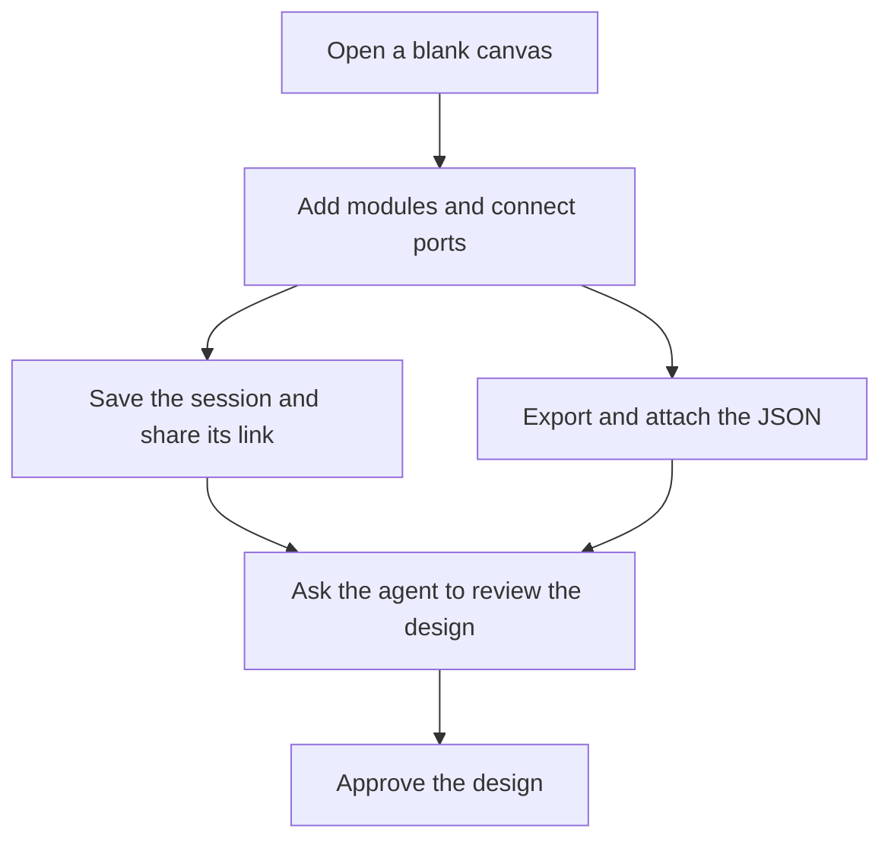

# Start a Design from an Empty Session

[日本語](../empty-session.md)

Create the system in RTSystemDesigner and hand the finished design to the agent. For a design proposed by the agent, follow the [quickstart](quickstart.md).

## 1. Open a blank canvas

To create a shareable design, send this request to Codex or Claude Code.

Use a chat working in the RTC-Agent-Tools checkout and ask the agent to follow its AGENTS.md.

> Create an empty RTSystemDesigner session and show me the link.

Open the link and check that the canvas is empty. Keep sensitive information out of public sessions. For a local integration, use the same session server to register, edit, and retrieve the design. [Local integration](local-designer.md)

If you plan to hand off a JSON file, open the [public RTSystemDesigner](https://nobu19800.github.io/RTSystemDesigner/) directly and start from its blank canvas.

The screenshot shows the blank canvas when the Designer is opened directly. In a registered session, **Save** is enabled.

## 2. Add modules and connections

1. Open **＋ モジュール追加** (Add module). To reuse an existing module, load the catalogs, select RTC, ROS 2 Node, or Hakoniwa Asset in the module kind filter, and narrow the results by name. To create one, click Add module inside the dialog, set **Module Kind**, and add the required ports.
2. Click each module on the canvas. Set names in **General**, types and directions in **Ports**, and implementation and runtime requirements in **Implementation → Requirements**. Use a unique instance name for each module.
3. Connect data sources to receivers and service consumers to providers. Record runtime mappings such as ROS 2 topic names and Hakoniwa PDU channels in Requirements when the diagram alone cannot express them. [Module settings reference](designer-module-settings.md)

### Example: Double an integer with a new RTC

Enter an integer in the existing `ConsoleIn` RTC. The new `DoubleInteger` RTC doubles it, and the existing `ConsoleOut` RTC displays the result.

1. Open **Add module**, load the catalogs, and filter by **RTC**. Select the Python versions of the bundled OpenRTM samples `ConsoleIn` and `ConsoleOut`. Name the instances `ConsoleIn0` and `ConsoleOut0`.
2. Click **Add module** inside the module selection dialog to create a new module. Select it on the canvas and enter these settings.

| Tab | Settings |
| --- | --- |
| **General** | Set Module Kind to **RTC**, Module Name to `DoubleInteger`, and Instance Name to `DoubleInteger0` |
| **General → Basic Profile** | Set Generation Language to **Python**, Version to `1.0.0`, Category to `Converter`, and Vendor to the author's name |
| **Ports** | Use **+ InPort** to add `in` and **+ OutPort** to add `out`. Set both Data Types to `RTC::TimedLong` |
| **Activity** | Set **Generate** to **ON** for `onExecute`. Leave `onInitialize` at its default of **ON** |
| **Implementation → Summary** | Double an integer and publish the result |
| **Implementation → Requirements** | When new data arrives on `in`, read one value and publish twice its value on `out` with the original timestamp. Publish only when a new input arrives. If the result falls outside the signed 32-bit integer range, skip the output and log it. |

3. Drag from each output handle to its corresponding input. Connect `ConsoleIn0.out → DoubleInteger0.in` and `DoubleInteger0.out → ConsoleOut0.in`. Both connections use `RTC::TimedLong`.

~~~mermaid
flowchart LR
    input["ConsoleIn0 Existing RTC"] -->|"out → in · RTC::TimedLong"| doubler["DoubleInteger0 New RTC · multiply by 2"]
    doubler -->|"out → in · RTC::TimedLong"| output["ConsoleOut0 Existing RTC"]
~~~

Save and hand off the design as described below. After approval, the agent generates and implements the new RTC. Once the system is running, enter `21` in ConsoleIn and check that ConsoleOut displays `42`.

## 3. Save and hand off the design

For a registered session, click **保存** (Save) and send the URL or ID in the same chat. For a file handoff, click **JSON出力** (Export JSON) and attach the exported version 2 file.

> Load and review this design.

Review the response, then correct and save the design if needed.

> Design approved.

Review the build result, then send the following when you want to run the system.

> Start the system.
