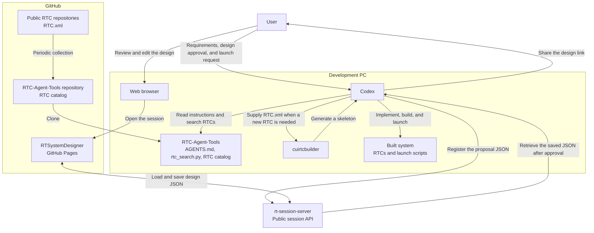

# RTC-Agent-Tools Detailed Operating Specification

[日本語](../operation-specification.md)

## System architecture

RTSystemDesigner provides the design editor. A separate session API stores the design JSON. After the user approves the design, Codex retrieves the saved JSON and uses it to build the system.

## Responsibilities and design approval

RTC-Agent-Tools supports catalog search, design exchange, profile conversion, and deployment preparation. The coding agent produces the system-specific design and implementation artifacts. Repository scripts process the inputs described below.

| Phase | Input | Output and completion criteria |
| --- | --- | --- |
| Design proposal | User requirements and module information | Version 2 proposal, connections, open questions, and review URL |
| Designer-first workflow | User-edited JSON or saved session | Review of the supplied design and any unresolved items |
| Design approval | Explicit user confirmation | Latest saved session or approved export retained as the implementation input |
| Implementation and build | Approved design, source revisions, environment settings | Selected existing sources, definitions and implementations for new RTCs, and build results |
| Execution and verification | Authorized execution scope and target environment | Connection, state, data-transfer, and shutdown observations, logs, and outstanding checks |

After approval, consult the final session, design provenance, catalogs, and selected sources in that order. Trace design changes to affected downstream artifacts. [Design workflow](../agents/en/design.md) · [Approved design and workspace](../agents/en/workspace.md)

## Session model and catalogs

A version 2 session has top-level fields `version: 2`, `id`, `name`, `description`, `components`, and `edges`. The value of `components[].data.moduleKind` identifies `rtc`, `hakoniwa`, or `ros2` modules. The diagram uses the node type `rtc` for all three. Edge endpoints refer to component and port IDs. Check names, directions, data types, and connection kinds.

- `rtc_catalog.json` contains basic RTC information, ports, and profile references. A compatible Designer fetches the referenced `RTC.xml` to load Activity, port, configuration, and documentation details. If fetching fails, the Designer can offer to add the module with basic information. For unspecified Activity values, `onInitialize` is on and the remaining callbacks are off. Explicit profile values take precedence.
- `openrtm_samples_catalog.json` stores bundled example profiles and installed launch settings. The Designer prefers the sample definition for a candidate with the same name and language.
- `hakoniwa_catalog.json` comes from Hakoniwa XML profiles and preserves catalog IDs, referenced component IDs, PDU channel IDs, profile sources, and hashes.
- `ros2_catalog.json` describes ROS 2 nodes, topics, services, and actions. Placement uses the catalog ID. Launch uses the package, executable, namespace, and instance name.

Store deployment and implementation information in `deployment`, `rtcConf`, `configuration`, and `implementation`. Use relative paths or named references in portable designs and resolve them in the deployment environment. Put planned ExcelControlpy and Calc ports in `data.ports`. Record sheet, starting cell or range, and advancement behavior in `data.implementation.requirements`. [Session format](../agents/en/session-format.md) · [Catalog format](../../catalog/README.md) · [Dynamic ports](../agents/en/dynamic-rtc-ports.md)

## Public session API

The public Designer displays the design. The public session server registers, retrieves, and saves session data. [Public RTSystemDesigner](https://nobu19800.github.io/RTSystemDesigner/) · [Service endpoints](../agents/en/services.md)

| Operation | Request | Result |
| --- | --- | --- |
| Register | `POST /api/sessions` with version 2 JSON | Returns a session ID |
| Retrieve | `GET /api/sessions/{sessionId}` | Returns saved system JSON |
| Save | `PUT /api/sessions/{sessionId}` from the Designer | Updates the saved design |

Use `designerUrl` when provided. Otherwise append `?session=<SESSION_ID>` to the public Designer URL. After approval, retrieve the saved design and retain the JSON used to start implementation.

## Connections and execution plans

| Connection | Runtime mapping |
| --- | --- |
| RTC to RTC | Verify the actual DataPort types and directions, or ServicePort interface types and Consumer/Provider roles. For different DataPort types, verify the approved custom serializer mapping. |
| ROS 2 to ROS 2 | Check fully qualified types and plan topic and service remappings. Match fully qualified action names. |
| RTC and ROS 2 | Use ROS2Transport and align the serializer, message type, topic, direction, DDS domain, and QoS. |
| RTC and Hakoniwa | Use the `hakoniwa` custom interface and a type-specific serializer. Match the robot, PDU channel, capacity, and layout. |
| Hakoniwa and ROS 2 | Model the PDU–ROS 2 bridge as a separate module with an explicit Hakoniwa PDU connection and ROS 2 topic connection. |

For ROS 2, `plan` prepares launch arguments. `run` checks the package and executable and launches the node with local `ros2 run`. Follow the selected system's instructions for external launchers, lifecycle transitions, component containers, and bridges. RTC startup, connection, activation, deactivation, and shutdown use deployment-specific commands derived from the approved design. [RTC runtime](../agents/en/runtime.md) · [ROS 2](../agents/en/ros2.md) · [Hakoniwa](../agents/en/hakoniwa-ros2.md)

## Artifacts and verification

For a new RTC, track the definition JSON, `RTC.xml`, Builder skeleton, implementation, and build results. Reuse the sources selected in the approved design for existing RTCs. Resolve plugins, parameters, and connections for each deployment target. The legacy `prepare_final_session.py` and `generate_runtime_batches.py` scripts apply to their original examples and legacy input format.

Record naming service registration, connections, component states, data transfer, rendering, and shutdown separately. When permission to operate a GUI is needed, follow the verification guide. If the agent skips GUI operation, report outstanding visual checks and provide instructions for the user. Link each result to the approved design, startup conditions, observations, and logs. [Generation](../agents/en/generation.md) · [Implementation](../agents/en/implementation.md) · [Verification](../agents/en/verification.md)
