# RTC-Agent-Tools Quickstart

[日本語](../quickstart.md)

Send five messages to Codex or Claude Code to build and run a joystick-controlled mobile robot in a physics simulator. The screenshots show a Raspberry Pi Mouse example on Windows. The screenshots contain Japanese UI and conversation text. Use the English prompts below. Component selection can vary with the environment and the approved design.

## Prepare an agent and a working folder

Create an empty working folder, such as `rtc-demo`. To use Codex, install it and sign in. [ChatGPT desktop app guide](https://learn.chatgpt.com/docs/app)

Claude Code can follow the same five prompts. Install it for your operating system, open a terminal in the working folder, run `claude`, and sign in. Start at step 1 in that session. [Official Claude Code installation guide](https://code.claude.com/docs/en/setup#install-claude-code)

If you are using Codex, select **+** next to **Projects** in the sidebar.

<a href="../images/quickstart/codex-add-project.png">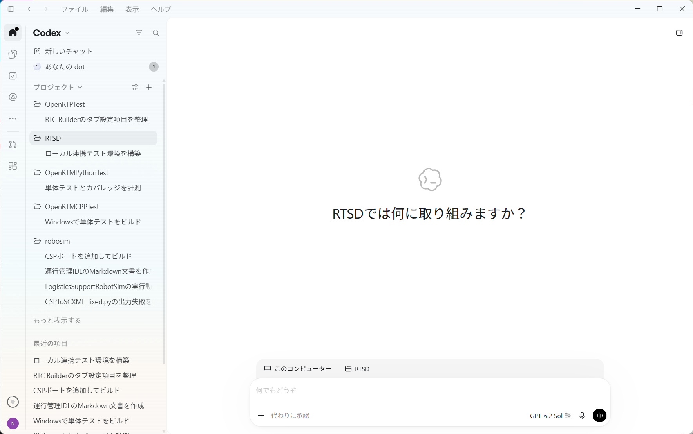</a>

Name the project, add your working folder as its source folder, and create it. Open a new chat in the project and use the same chat for the remaining messages.

<a href="../images/quickstart/codex-project-folder.png">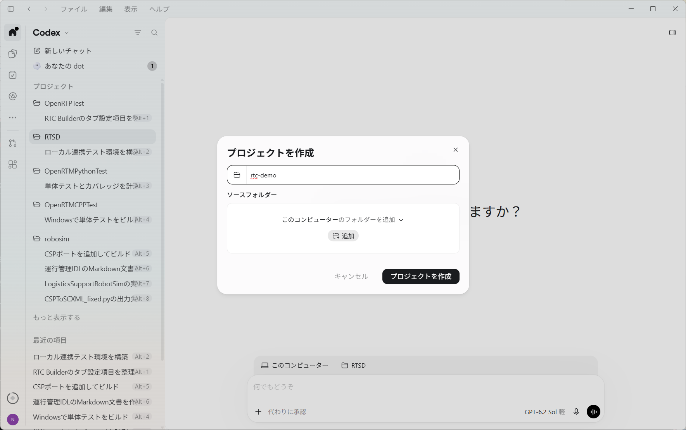</a>

## 1. Clone RTC-Agent-Tools

> Clone https://github.com/Nobu19800/RTC-Agent-Tools.git into this working folder.

Check that the agent cloned the repository directly under the working folder. If Git is missing, install it for the shell that will do the cloning. [Git installation instructions](../../AGENTS.md#git-installation)

<a href="../images/quickstart/codex-message-1.png">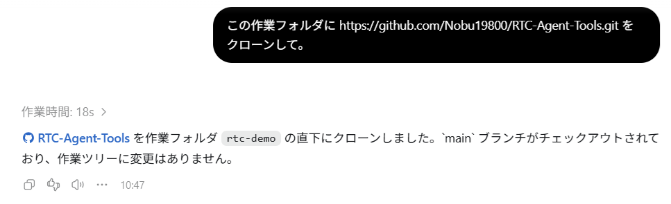</a>

## 2. Request the system and review the proposal

> Follow AGENTS.md and build a mobile robot simulation controlled by a GUI joystick.

Check the component list and open the design session link from the reply.

<a href="../images/quickstart/codex-message-2.png">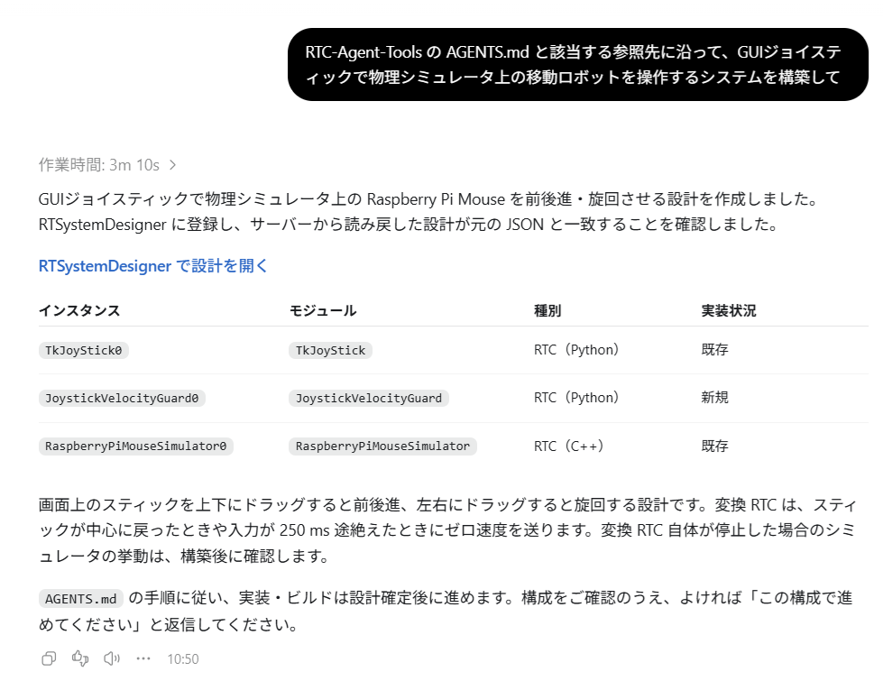</a>

Review the components, port directions and types, and connections. Ask the agent for any changes or edit the design and click **Save**. Keep sensitive information out of sessions registered with the public service. [Public RTSystemDesigner](https://nobu19800.github.io/RTSystemDesigner/)

<a href="../images/quickstart/rtsystemdesigner.png">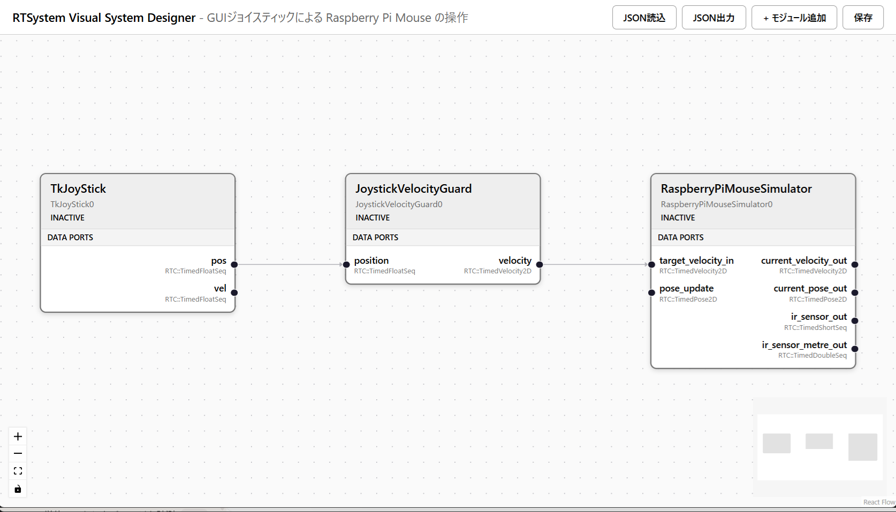</a>

## 3. Approve the design

After reviewing the design and saving any edits, send this message.

> Design approved.

The agent loads the approved design, obtains the required components, and prepares the implementation, build, and runtime configuration. Review the build result and any prerequisites the agent reports.

<a href="../images/quickstart/codex-message-3.png">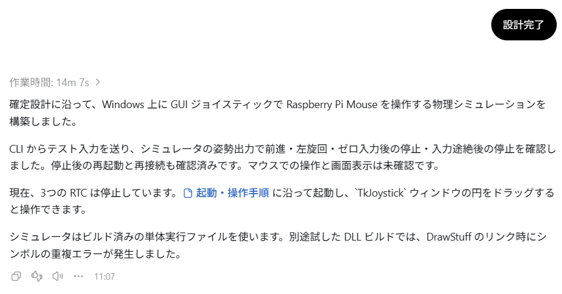</a>

## 4. Start the system and check the windows

> Start the system.

Check the startup report and connection state. Follow the instructions in the reply to check the GUI yourself.

<a href="../images/quickstart/codex-message-4.png">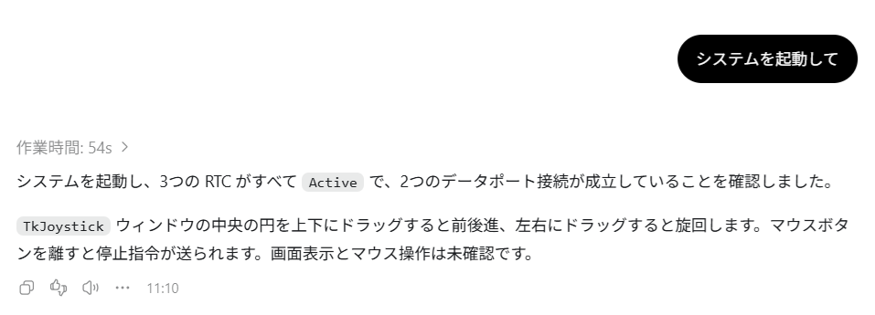</a>

1. Open the `TkJoystick` and simulator windows.
2. Drag the center handle up or down. The robot should move forward or backward.
3. Drag the handle left or right. The robot should turn.
4. Release the mouse button. The robot should stop.

<a href="../images/quickstart/joystick.png">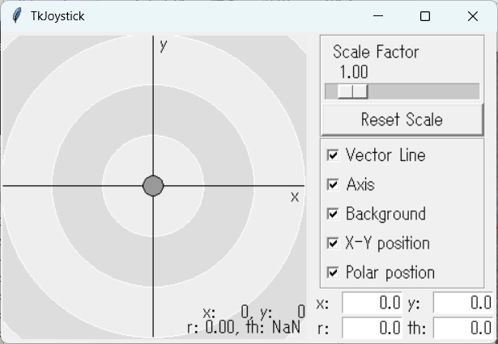</a>

<a href="../images/quickstart/raspberry-pi-mouse-simulator.png">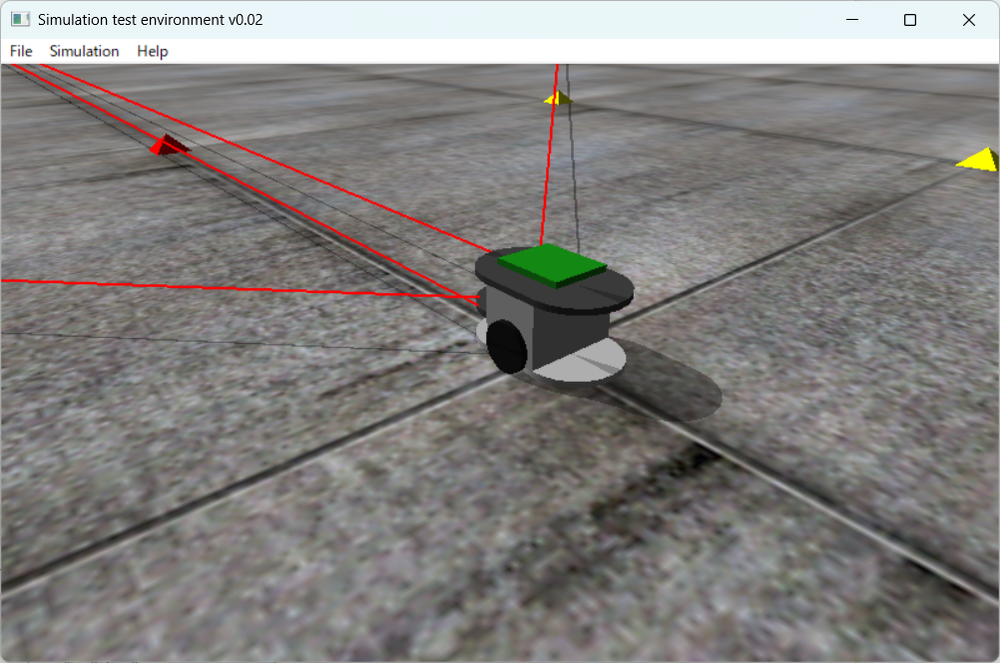</a>

If you use RTSystemEditor, you can also inspect the active RTCs and port connections.

<a href="../images/quickstart/rtsystemeditor.png">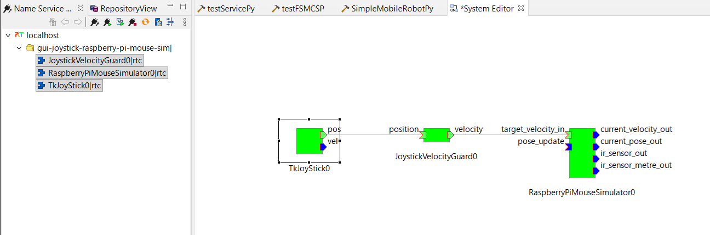</a>

## 5. Stop the system

> Stop the system.

Check the reply for confirmation that the RTC processes have exited and that their entries have been removed from the naming service.

<a href="../images/quickstart/codex-message-5.png">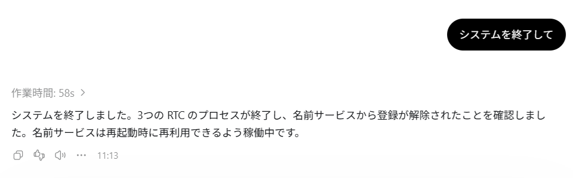</a>

## Related documentation

- [Environment setup](setup.md)
- [Detailed operating specification](operation-specification.md)
- [Operation manual](operation-manual.md)
