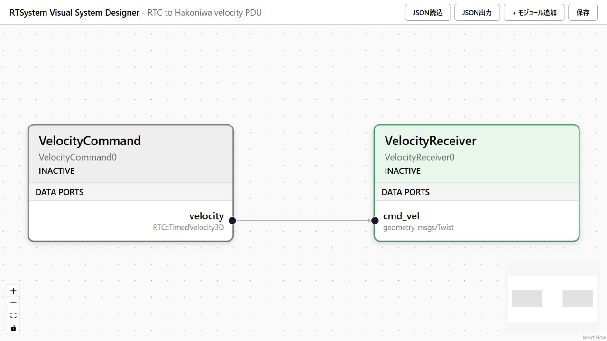
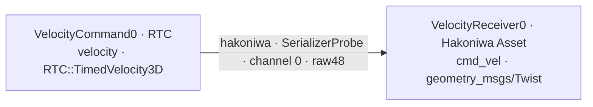

# Connect an RTC to a Hakoniwa Asset

[日本語](../rtc-hakoniwa.md)

Connect a typed RTC DataPort to an asset that reads or writes native Hakoniwa PDUs. Ask the agent to prepare the system, review the design, then request startup. The agent handles environment setup, plugin configuration, connection, and data checks.

## 1. Design the connection

Use a chat working in the RTC-Agent-Tools checkout and ask the agent to follow its AGENTS.md.

> Design a system that sends RTC velocity commands to a simulated Hakoniwa asset over a PDU.

In RTSystemDesigner, review both ports and the direction of the connection. For a velocity command, one mapping is from `RTC::TimedVelocity3D` to a Hakoniwa `geometry_msgs/Twist` PDU. Record the actual asset's robot name, PDU name, channel ID, capacity, layout, coordinate frame, and units. Document the same details separately for any reverse connection. [Connection contract](../agents/en/hakoniwa-serializer.md)

### Registered example configuration

The example places `VelocityCommand0` and `VelocityReceiver0` as new test modules. The design writes velocity commands to channel 0 on `SerializerProbe` as a 48-byte Twist PDU.

## 2. Build and start

> Design approved.

The agent prepares the selected Recipe's Workspace and Foundation on Ubuntu or WSL2 and checks the Python runtime and native Hakoniwa bindings.
The agent loads the transport plugin and serializer through `rtc.conf`. The connection uses `dataport.interface_type: hakoniwa` and the `dataport.marshaling_type` for the selected type and layout. If the Hakoniwa endpoint has no CORBA port, use the documented single-port connection procedure.

> Start the system.

The agent prepares the Conductor and PDU region in the order specified by the Recipe, then starts, connects, and activates the RTC. Loading the plugin and preparing the PDU region are separate steps. [Environment setup](setup.md) · [Python plugin and native verification example](../../examples/hakoniwa_transport/README.md)

## 3. Verify the data and stop

For example, send `vx=0.1` m/s with all other fields set to zero. Check that the target PDU reports `linear.x=0.1` and zero in the other fields. Check both the connection log and the PDU values actually read. For a system with a viewer, follow the agent's instructions to check motion on screen.

> Stop the system.

[OpenRTM-aist serialization and transport plugins](rtc-transport-plugins.md)
