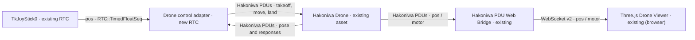

# Connect an OpenRTM joystick to a Hakoniwa drone

[日本語](../rtc-hakoniwa.md)

Use the OpenRTM-aist Python `TkJoyStick` GUI sample to command horizontal motion in the Hakoniwa drone simulator.

## 1. Design the system

> Design a system that controls a Hakoniwa simulated drone with the OpenRTM-aist Python TkJoyStick sample and shows it in the Three.js viewer through a WebSocket bridge.

In RTSystemDesigner, check the connection from `TkJoyStick0.pos` to the adapter and the Hakoniwa PDU connections between the adapter and the drone. The `pos` port outputs canvas X and Y coordinates. The `vel` port outputs left and right values for a wheeled mobile robot, so this example uses `pos`.

Configure the adapter's input scaling, axis directions, dead zone, and movement and speed limits. Use explicit actions for takeoff and landing. Centered or stale input stops new move requests. Wait for a response to the previous request before sending another.

| Drone PDU | Channel | Capacity | Use |
| --- | --- | --- | --- |
| `pos` | 1 | 72 B | Read position and attitude |
| `drone_cmd_takeoff` | 6 | 88 B | Takeoff request and response |
| `drone_cmd_move` | 7 | 104 B | Absolute position request and response |
| `drone_cmd_land` | 8 | 88 B | Landing request and response |

These values apply to the catalog's legacy API profile. Compare them with the selected Recipe's PDU definitions before running. The `pos` PDU uses the `geometry_msgs/Twist` type to carry position and attitude. Movement requests use `hako_msgs/HakoDroneCmdMove`. [PDU profile](../../profiles/iso22166-202/drone-three-point/drone-service.xml)

## 2. Build and start the system

> Design complete. Start TkJoyStick and the Hakoniwa drone system.

The agent prepares the Workspace and Foundation for the selected Recipe and runs the installed `TkJoyStickComp.py` with a Tkinter-enabled OpenRTM-aist Python runtime. The adapter uses `dataport.interface_type=hakoniwa`, a PDU-specific `dataport.marshaling_type`, and the same shared-memory domain as the drone. Use the drone's built-in Conductor when supplied by the Recipe. Enable control after the simulator is running and simulation time and `pos` are readable. [Environment setup](setup.md) · [OpenRTM transport plugins](rtc-transport-plugins.md)

## 3. Verify and stop the system

From Windows, refresh the shared `localhost:2809` in RTSystemEditor's Name Service view. Check that `TkJoyStick0` and `DroneJoystickAdapter0` are listed and their `pos → joystick` ports are connected. Use the **TkJoystick (Ubuntu)** window. The standard GUI has no takeoff or landing buttons. Ask the agent to initiate takeoff.

> Take off the simulated drone.

Move the TkJoyStick control horizontally. The agent compares the received `RTC::TimedFloatSeq`, move request PDU, successful response, and `Drone/pos` before and after the move. Check that centering the joystick stops new move requests.

The agent registers the WebSocket bridge before starting the simulation. Open the 3D viewer URL provided by the agent and click **Connect**. The **Connected** status indicates an active connection. If the drone leaves the frame after takeoff, select **Follow**, **Front**, or **Overview** to switch cameras.

The standard `TkJoyStick0` connected to the standalone `DroneJoystickAdapter0` produced successful move responses and changes in `Drone/pos` after joystick input. The adapter requests a horizontal speed of **6.0 m/s** and limits each target displacement to **5.0 m**. The speed is a command to the simulator.

> Stop the system.

The agent confirms that both RTC registrations are gone and that the bridge's WebSocket and viewer's HTTP listeners for this run have stopped.

[Static analysis and unit tests for the drone control adapter](drone-adapter-checks.md)
