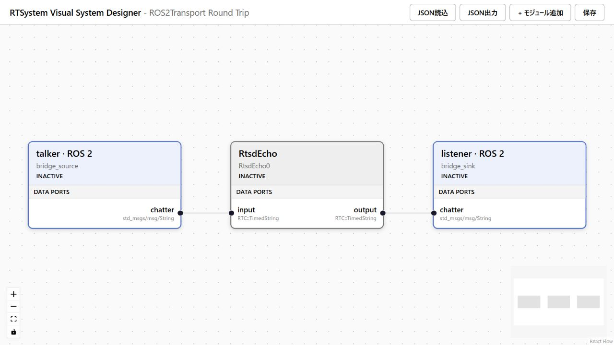
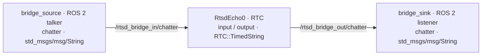

# Connect an RTC to ROS 2

[日本語](../rtc-ros2.md)

Use OpenRTM-aist ROS2Transport to connect RTC DataPorts to ROS 2 publishers and subscribers. In this example, ROS 2 sends a string to an RTC, which returns a modified string to ROS 2.

## 1. Design the round trip

Use a chat working in the RTC-Agent-Tools checkout and ask the agent to follow its AGENTS.md.

> Design a string round trip between ROS 2 and an echo RTC using ROS2Transport.

| Source | Destination | Topic |
| --- | --- | --- |
| ROS 2 talker | RTC InPort | `/rtsd_bridge_in/chatter` |
| RTC OutPort | ROS 2 listener | `/rtsd_bridge_out/chatter` |

In RTSystemDesigner, check `RTC::TimedString` on the RTC ports and `std_msgs/msg/String` on the ROS 2 endpoints. Review publisher and subscriber roles, topic names, the ROS2Transport implementation, and the DDS backend. [Example session](../../examples/ros2-transport/session.json)

### Registered example configuration

The design uses existing implementations from the bundled round-trip test. Both connections use ROS2Transport.

## 2. Build and start

> Design approved.

The agent prepares compatible ROS 2 and OpenRTM-aist runtimes and generates `rtc.conf` from the approved design. Match DDS domain, discovery scope, QoS, and type mappings. If the C++ RTC must appear by name in the ROS graph, select a transport configuration that supports named discovery.

> Start the system.

[ROS2Transport configuration](../agents/en/ros2-transport.md) · [Jazzy round-trip test for Python and C++](../../examples/ros2-transport/README.md)

## 3. Verify the round trip and stop

From the same ROS 2 environment, the agent checks both topics with `ros2 topic info` and confirms the modified string with `ros2 topic echo /rtsd_bridge_out/chatter` or the listener log. For named discovery, also use `ros2 node list` and `ros2 node info` to check the RTC node and its endpoints.

> Stop the system.

The bundled round-trip test stops its test processes after reporting the result.

[OpenRTM-aist serialization and transport plugins](rtc-transport-plugins.md)
