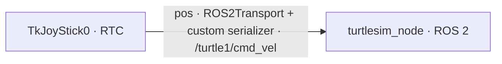

# RTC–ROS 2 integration

[日本語](../rtc-ros2.md)

Use the standard OpenRTM-aist Python `TkJoyStick` GUI sample to control a turtle in ROS 2 Jazzy Turtlesim.



## 1. Design the system

> Design a system that controls ROS 2 Turtlesim with the standard TkJoyStick sample.

In RTSystemDesigner, check the connection from the existing `TkJoyStick0.pos` to the existing `turtlesim_node` subscriber. A custom ROS2Transport serializer converts `RTC::TimedFloatSeq` to `geometry_msgs/msg/Twist` on `/turtle1/cmd_vel`. It maps Y to forward speed (`linear.x`) and X to turn rate (`angular.z`), bounds both values, and produces zero velocity for centered or invalid input. The example uses the standard TkJoyStick GUI and ports.

## 2. Build and start the system

> Design complete. Start TkJoyStick and Turtlesim.

The agent starts Turtlesim and TkJoyStick in the same ROS 2 Jazzy domain. It runs Turtlesim with `ros2 run turtlesim turtlesim_node` and loads ROS2Transport and the custom serializer through the RTC manager's `rtc.conf`.

The standard TkJoyStick sample creates its RTC after manager startup, so startup preconnect may miss `pos`. After registration, the agent checks for a connector on `pos`. If missing, it uses `PortService.connect` on that port with `dataport.interface_type=ros2`, `dataport.dataflow_type=push`, `dataport.marshaling_type=ros2:tkjoystick/Twist`, and `dataport.ros2.topic=/turtle1/cmd_vel`, then activates the RTC. [ROS2Transport settings](agents/en/ros2-transport.md)

## 3. Verify and stop the system

Drag the joystick away from center and watch the turtle move in Turtlesim. Release the joystick to stop. The agent checks the velocity command and turtle position, and verifies that Turtlesim's receive timeout stops motion when publishing ceases.

```bash
ros2 topic info /turtle1/cmd_vel
ros2 topic echo /turtle1/cmd_vel
ros2 topic echo /turtle1/pose
```

> Stop the system.

The agent verifies that both processes have exited and the `TkJoyStick0` registration is gone. The shared NameService stays running.

In WSL2 with Jazzy, injecting `[0, 60]` through the standard input callback published `linear.x=1.0` and moved the turtle's X position from approximately 5.54 to 8.57. Both centered input and ceasing publication stopped the turtle. The user also verified mouse operation with both windows open. In this setup, `ros2 topic echo` received `Twist` even when `ros2 topic info` reported zero publishers. Verify delivery using message samples and position changes as well.

[Custom serializer](../../examples/ros2-transport/TkJoyStickTwistSerializer.py)

[OpenRTM transport plugins](rtc-transport-plugins.md)
