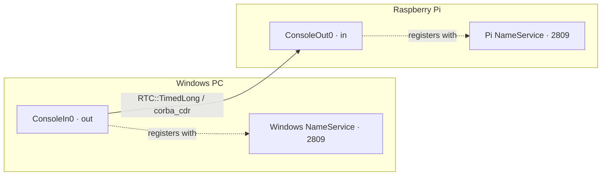

# Deploy RTCs across Windows and Raspberry Pi

[日本語](../windows-raspberry-pi.md)

This example sends an integer typed into a Windows console to a Raspberry Pi. It connects the OpenRTM-aist Python SimpleIO sample components across two machines.



## 1. Prepare the machines

Place RTC-Agent-Tools in your Windows workspace. Boot Raspberry Pi OS and confirm the Pi's IP address, SSH username, and SSH host key fingerprint. Add your public key so the agent can connect through SSH. On first connection, compare the host key fingerprint with the value obtained on the Pi. Keep passwords and private keys out of the chat and design.

Check that Windows and the Pi can communicate over the LAN. This example uses TCP 2809 for each NameService and TCP 2810 for each RTC's CORBA endpoint. Windows also needs SSH access to the Pi. Check both IP addresses before startup.

## 2. Ask the agent to design the system

> Follow the RTC-Agent-Tools AGENTS.md and design a system that sends integers from Windows ConsoleIn to Raspberry Pi ConsoleOut. The Pi IP is 172.31.222.98 and the SSH user is robot1-pi.

Replace the Pi IP and username with your own values. In RTSystemDesigner, check the `RTC::TimedLong` connection from the Python `ConsoleIn0.out` to `ConsoleOut0.in`. The agent fills in **Deployment → Host** for each RTC. Select a node to review or edit that field. In this example, use `Windows PC` for `ConsoleIn0` and `Raspberry Pi` for `ConsoleOut0`. The deployment settings below specify the connection IP addresses. The diagram displays each configured host on its node card. Save any changes to the session before telling the agent the design is complete.

> Design complete. Start the system and open an interactive ConsoleIn window on Windows.

## 3. Deploy and start the system

The agent performs this step. It uses the available OpenRTM-aist Python and rtshell on Windows and prepares the Pi runtime over SSH. For this example, the Pi ran Raspberry Pi OS based on Debian 13 on ARM64. The agent built omniORB and omniORBpy 4.3.4 under the user's home directory and installed OpenRTM-aist Python 2.1.0 in a dedicated virtual environment.

The agent starts or reuses one NameService on each machine and registers each RTC on its own machine. Windows and WSL2 on the same PC share an instance. The example used the following values.

| RTC | `corba.nameservers` | `corba.endpoints` |
| --- | --- | --- |
| Windows ConsoleIn0 | `172.31.222.246:2809` | `172.31.222.246:2810` |
| Pi ConsoleOut0 | `172.31.222.98:2809` | `172.31.222.98:2810` |

After checking both registrations, the agent runs these commands on Windows.

```powershell
rtcon -d -n windows-pi-demo -p dataport.interface_type=corba_cdr 172.31.222.246:2809/ConsoleIn0.rtc:out 172.31.222.98:2809/ConsoleOut0.rtc:in
rtact 172.31.222.98:2809/ConsoleOut0.rtc
rtact 172.31.222.246:2809/ConsoleIn0.rtc
```

## 4. Verify and stop the system

In the RTSystemEditor Name Service view, add `localhost:2809` and `172.31.222.98:2809` for this setup. The Windows service lists `ConsoleIn0.rtc`, and the Pi service lists `ConsoleOut0.rtc`. Type an integer into Windows ConsoleIn and ask the agent to check the received value.

> Check whether ConsoleOut on the Raspberry Pi received the integer I just entered.

For this deployment, the agent can check the Pi log with the following command.

```powershell
ssh robot1-pi@172.31.222.98 'tail -n 20 ~/rtc-agent-simpleio/logs/console-out.stdout.log'
```

> Stop the system.

The agent confirms that both RTCs have stopped and their registrations are gone. In this example, it also stops the dedicated Pi NameService and leaves the shared Windows NameService running.
