# RTC-Agent-Tools クイックスタート

[English](en/quickstart.md)

Codex または Claude Code に5つのメッセージを順に送り、GUI ジョイスティックで物理シミュレータ上の移動ロボットを操作する。画面例は Windows 上で Raspberry Pi Mouse を操作したときのもので、選ばれるコンポーネントや構成は実行環境と確定した設計によって変わる。

## エージェントと作業フォルダを準備する

作業用に空のフォルダを作成する。この例では `rtc-demo` とする。Codex を使う場合は、Codex をインストールしてサインインする。[Codex を使うための ChatGPT デスクトップアプリの案内](https://learn.chatgpt.com/docs/app)

Claude Code でも同じ5つのメッセージを使える。利用する OS 向けの手順でインストールし、作業フォルダを開いた端末で `claude` を起動してサインインする。そのセッションで手順1から進める。[Claude Code の公式インストール手順](https://code.claude.com/docs/en/setup#install-claude-code)

Codex を使う場合は、サイドバーにある「プロジェクト」横の「＋」を押す。

<a href="images/quickstart/codex-add-project.png">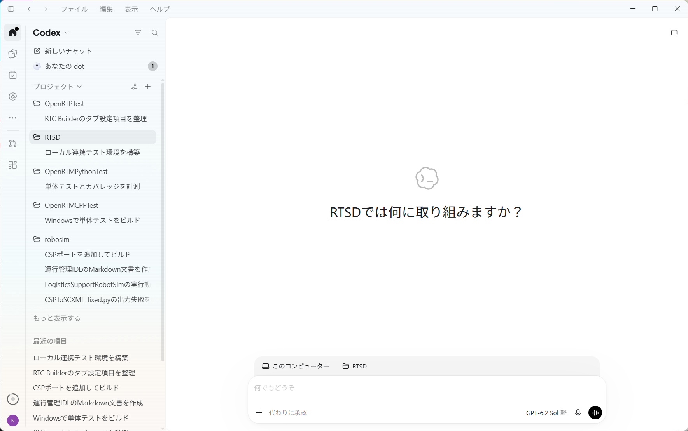</a>

プロジェクト名を入力し、ソースフォルダーに作成した作業フォルダを追加する。「プロジェクトを作成」を押し、そのプロジェクトで新しいチャットを開く。以降のメッセージは同じチャットで送る。

<a href="images/quickstart/codex-project-folder.png">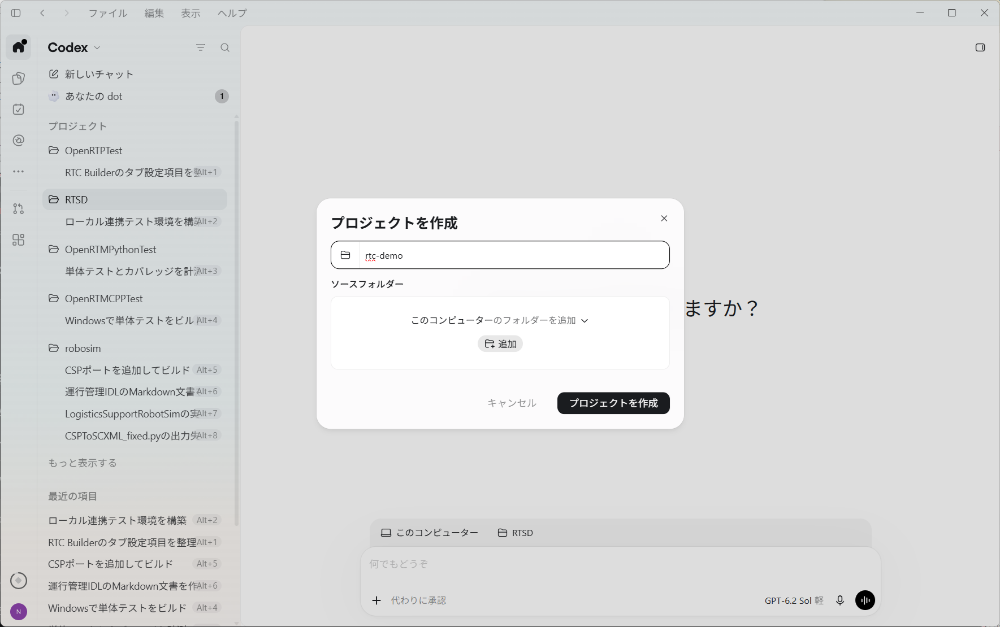</a>

## 1. RTC-Agent-Tools をクローンする

> この作業フォルダに https://github.com/Nobu19800/RTC-Agent-Tools.git をクローンして。

作業フォルダの直下に `RTC-Agent-Tools` が作成されたことを、エージェントの返信で確認する。Git の導入が必要な場合は、利用環境に合った手順で導入してからクローンする。

<a href="images/quickstart/codex-message-1.png">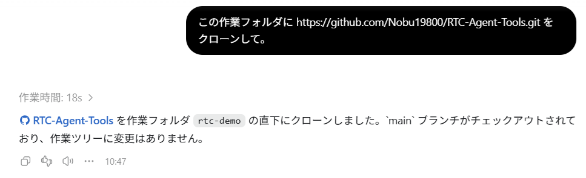</a>

## 2. システムの構築を依頼し、設計案を確認する

> AGENTS.md に沿って、GUI ジョイスティックで移動ロボットを操作するシミュレーションを作って。

エージェントの返信で、コンポーネント一覧と設計セッションのリンクを確認する。

<a href="images/quickstart/codex-message-2.png">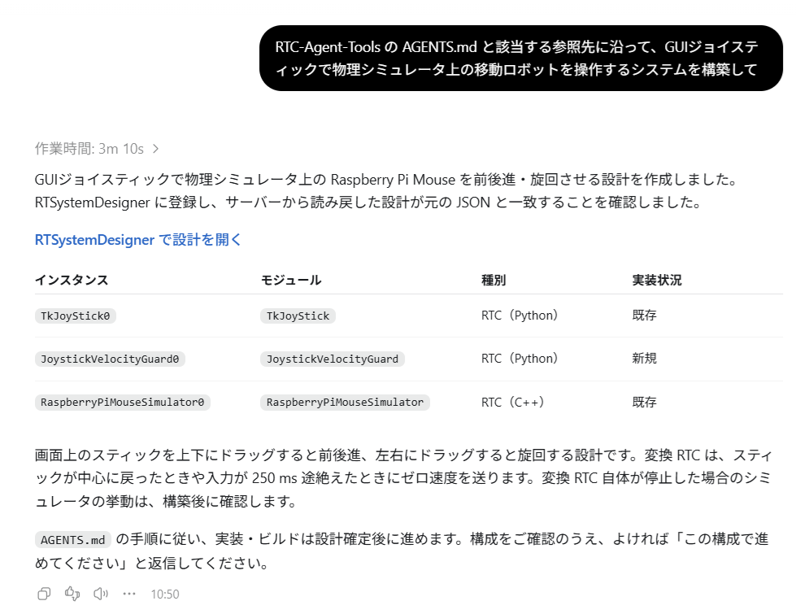</a>

返信のセッションリンクから公開版 RTSystemDesigner を開き、コンポーネント、ポートの型と方向、接続を確認する。修正する場合は、Codex に伝えるか、画面で編集して「保存」を押す。設計は公開サービスに登録されるため、機密情報を入力しない。[公開版 RTSystemDesigner](https://nobu19800.github.io/RTSystemDesigner/)

<a href="images/quickstart/rtsystemdesigner.png">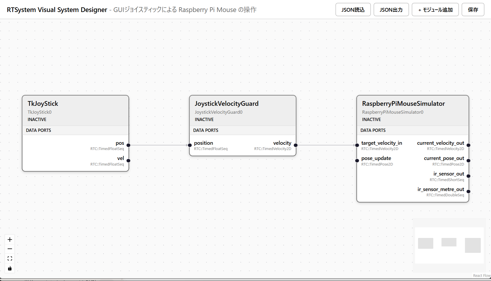</a>

## 3. 設計完了を伝える

設計に問題がなく、変更が保存されていることを確認してから送る。

> 設計完了

エージェントが確定設計を読み込み、必要なコンポーネントの取得、実装、ビルド、実行設定を進める。返信で構築結果と起動に必要な条件を確認する。

<a href="images/quickstart/codex-message-3.png">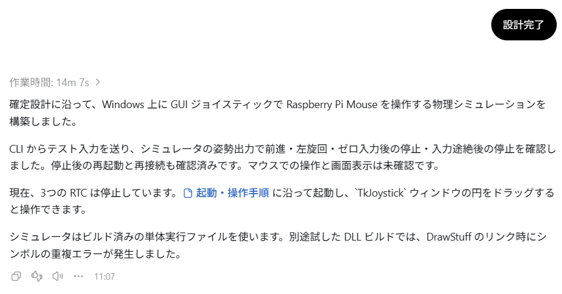</a>

## 4. 起動して画面で確認する

> システムを起動して

エージェントの返信で起動結果と接続状態を確認する。画面操作の確認は、ユーザーが実際のシミュレータ画面を見ながら行う。

<a href="images/quickstart/codex-message-4.png">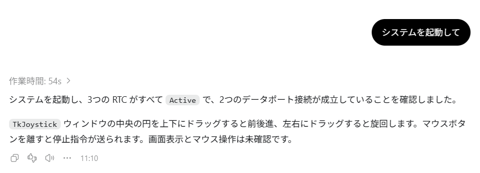</a>

以下は画面例の操作手順である。実際の構成に応じて エージェントが案内した操作に従う。

1. `TkJoystick` とシミュレータのウィンドウを開く。
2. ジョイスティック中央の円を上下にドラッグし、ロボットが前後に移動することを確認する。
3. 円を左右にドラッグし、ロボットが旋回することを確認する。
4. マウスボタンを離し、ロボットが停止することを確認する。

<a href="images/quickstart/joystick.png">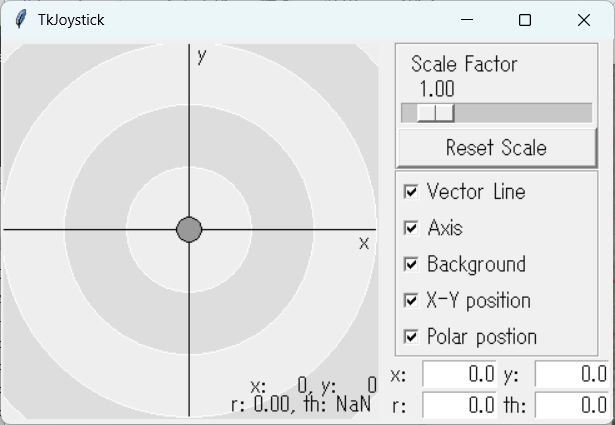</a>

<a href="images/quickstart/raspberry-pi-mouse-simulator.png">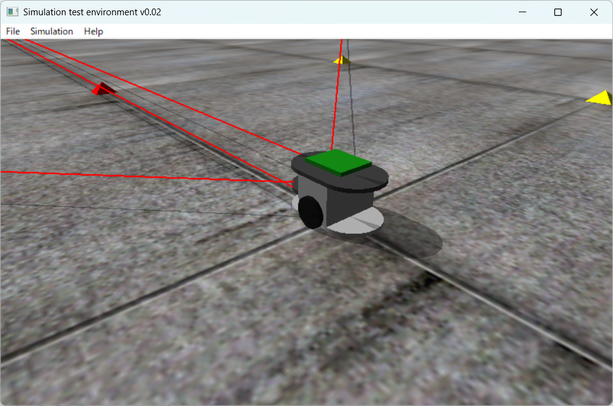</a>

RTSystemEditor を使う場合は、起動中の RTC と接続も確認できる。

<a href="images/quickstart/rtsystemeditor.png">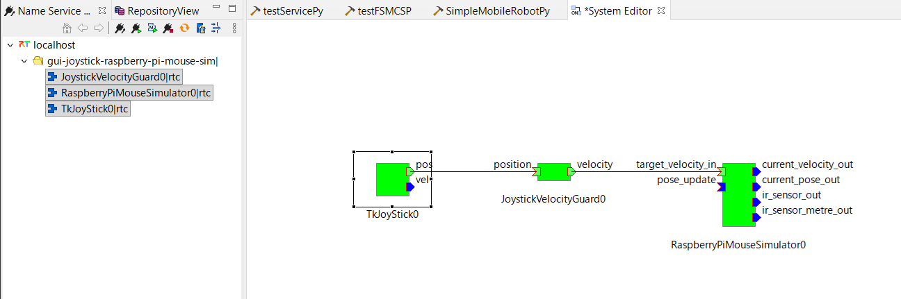</a>

## 5. システムを終了する

> システムを終了して

エージェントの返信で、対象の RTC プロセスの終了と名前サービスからの登録解除を確認する。

<a href="images/quickstart/codex-message-5.png">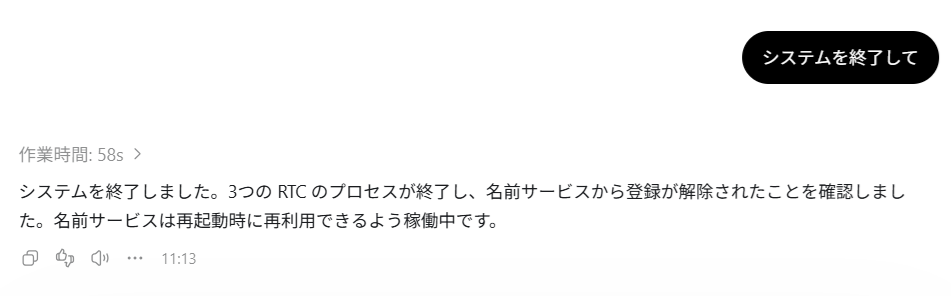</a>

## 関連ドキュメント

- [環境構築手順書](setup.md)
- [詳細な動作仕様書](operation-specification.md)
- [動作マニュアル](operation-manual.md)
