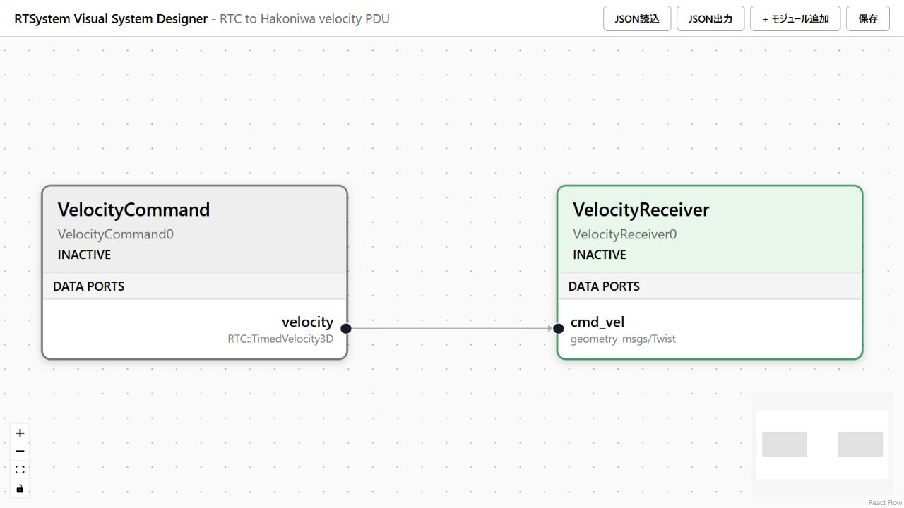
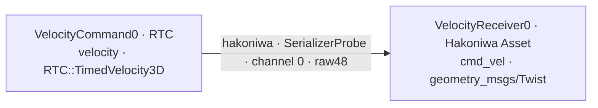

# RTC–箱庭アセット連携手順

[English](en/rtc-hakoniwa.md)

型付き DataPort を持つ RTC と、箱庭のネイティブ PDU を読み書きするアセットを接続する。利用者はエージェントに構築を依頼し、設計を確認してから起動を指示する。環境の準備、プラグインの設定、接続とデータの確認はエージェントが行う。

## 1. 設計する

RTC-Agent-Tools を配置した作業フォルダのチャットで、エージェントに AGENTS.md に従うよう伝えておく。

> RTC の速度指令を箱庭 PDU でシミュレーション用アセットに送る構成を設計して。

確定する前に RTSystemDesigner で RTC とアセットのポート、接続方向を確認する。たとえば速度指令では、RTC の `RTC::TimedVelocity3D` を箱庭側の `geometry_msgs/Twist` PDU に変換する。実際に選定したアセットの PDU 定義に合わせ、ロボット名、PDU 名、チャンネル ID、容量、バイナリ配置、座標系、単位を設計に記録する。逆方向の転送が必要なら、その接続についても同じ情報を確認する。[接続契約](agents/ja/hakoniwa-serializer.md)

### 登録した構成例

構成例では `VelocityCommand0` と `VelocityReceiver0` を新規の試験用モジュールとして配置した。速度指令を `SerializerProbe` のチャンネル 0 に、48 バイトの Twist PDU として書き込む設計である。

## 2. 構築して起動する

1. 「設計完了」と伝える。エージェントは配備先の Ubuntu または WSL2 に選定した Recipe の Workspace と Foundation を準備し、対象の Python と箱庭のネイティブバインディングを確認する。
2. エージェントは RTC の `rtc.conf` で転送プラグインとシリアライザをロードし、接続に `dataport.interface_type: hakoniwa` と型・レイアウトに合う `dataport.marshaling_type` を設定する。箱庭端点が CORBA ポートを公開しない構成では、確認済みの単一ポート接続手順を使う。
3. 「システムを起動して」と伝える。エージェントは選定した Recipe の順序で Conductor と PDU 領域を準備し、RTC を起動・接続・活性化する。プラグインのロードと PDU 領域の準備は別工程である。[環境構築手順書](setup.md) · [Python 転送プラグインとネイティブ検証例](../examples/hakoniwa_transport/README.md)

## 3. 値を照合して終了する

たとえば `vx=0.1` m/s、その他の成分をゼロにした試験値を送り、対象 PDU の `linear.x` が `0.1`、他の成分がゼロであることを照合する。接続ログに加え、実際に読み取った PDU 値を確認する。ビューア付きの場合は、エージェントが案内する画面で利用者が動作を確認する。確認後、「システムを終了して」と伝える。

[OpenRTM-aist の型変換と通信プラグイン](rtc-transport-plugins.md)
