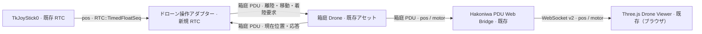

# RTC–箱庭アセット連携手順

[English](en/rtc-hakoniwa.md)

OpenRTM-aist Python 版の GUI サンプル `TkJoyStick` で、箱庭のドローンシミュレーターに水平移動を指示します。

## 1. 設計する

> OpenRTM-aist Python の TkJoyStick で箱庭のドローンを操作し、WebSocket ブリッジ経由で Three.js ビューアに表示するシステムを設計して。

RTSystemDesigner で `TkJoyStick0.pos` から操作アダプターへの接続と、アダプターから Drone への箱庭 PDU 接続を確認します。`pos` はキャンバスの X・Y 座標を出力します。`vel` は車輪型移動ロボット向けの左・右の値を出力するため、この例では `pos` を使います。

アダプターでは入力の正規化、座標軸と符号、デッドゾーン、移動幅と速度の上限を設定します。離陸と着陸は明示操作とし、中央入力や入力途絶時は新しい移動要求を発行しません。直前の要求への応答を確認してから次の要求を送ります。

| Drone の PDU | チャンネル | 容量 | 用途 |
| --- | --- | --- | --- |
| `pos` | 1 | 72 B | 位置と姿勢の読み取り |
| `drone_cmd_takeoff` | 6 | 88 B | 離陸の要求と応答 |
| `drone_cmd_move` | 7 | 104 B | 絶対位置への移動の要求と応答 |
| `drone_cmd_land` | 8 | 88 B | 着陸の要求と応答 |

上表はカタログの legacy API 構成です。実行時は選定した Recipe の PDU 定義と照合します。`pos` の型名は `geometry_msgs/Twist` ですが、この PDU は位置と姿勢を格納します。移動は `hako_msgs/HakoDroneCmdMove` で指示します。[PDU プロファイル](../profiles/iso22166-202/drone-three-point/drone-service.xml)

## 2. 構築して起動する

> 設計完了。TkJoyStick と箱庭ドローンのシステムを起動して。

エージェントが選定した Recipe の Workspace と Foundation を準備し、Tkinter 付きの OpenRTM-aist Python で既存の `TkJoyStickComp.py` を起動します。アダプターは `dataport.interface_type=hakoniwa` と PDU ごとの `dataport.marshaling_type` を設定し、ドローンと同じ共有メモリ領域を使います。ドローンが Conductor を内蔵する構成ではその 1 つを使います。箱庭側が稼働状態になり、時刻と `pos` が読み取れてから操作を有効にします。[環境構築手順書](setup.md) · [型変換と通信プラグイン](rtc-transport-plugins.md)

## 3. 確認して終了する

RTSystemEditor のネームサービスビューで、Windows からは共有先の `localhost:2809` を更新します。`TkJoyStick0` と `DroneJoystickAdapter0` の両方が表示され、`pos → joystick` が接続されていることを確認します。操作画面は **TkJoystick (Ubuntu)** です。標準 GUI に離着陸ボタンはないため、離陸はエージェントに依頼します。

> ドローンを離陸させて。

利用者は TkJoyStick の画面から水平入力を行います。エージェントは、受信した `RTC::TimedFloatSeq`、移動要求 PDU、成功応答、移動前後の `Drone/pos` を照合します。中央に戻した後は新しい移動要求が出ないことを確認します。

エージェントは WebSocket ブリッジをシミュレーション開始前に登録します。案内された 3D ビューアの URL を開き、**Connect** を押します。**Connected** と表示されていれば接続済みです。離陸して機体が画面から外れたときは、**追従**・**前方**・**全体**のいずれかを押して視点を切り替えてください。

標準の `TkJoyStick0` と独立した `DroneJoystickAdapter0` を接続した構成で、ジョイスティック操作後の移動成功応答と `Drone/pos` の変化を確認しました。操作アダプターの水平移動要求は速度 **6.0 m/s**、1 回の目標移動距離は最大 **5.0 m** に設定しています。速度の値はシミュレーターへの指令値です。

> システムを終了して。

エージェントが、両 RTC の登録、ブリッジの WebSocket、ビューアの HTTP が今回の起動分について終了したことを確認します。

[操作アダプターの静的解析・単体テスト](drone-adapter-checks.md)
