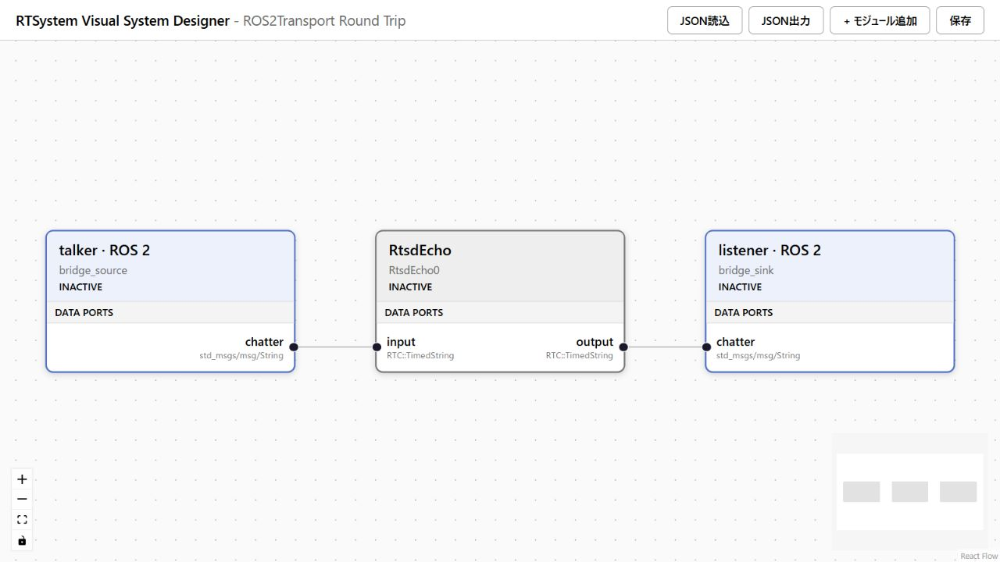
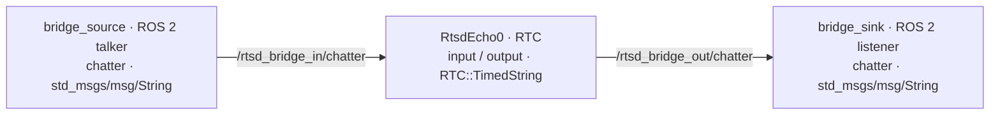

# RTC–ROS 2 連携手順

[English](en/rtc-ros2.md)

OpenRTM-aist の ROS2Transport を使い、RTC DataPort と ROS 2 の Pub/Sub を接続します。例では ROS 2 から RTC に文字列を送り、RTC が加工した文字列を ROS 2 に返します。

## 1. 設計する

RTC-Agent-Tools を配置した作業フォルダのチャットで、エージェントに AGENTS.md に従うよう伝えておきます。

> ROS 2 とエコー RTC が ROS2Transport で文字列を往復する構成を設計して。

| 送信元 | 接続先 | トピック |
| --- | --- | --- |
| ROS 2 talker | RTC InPort | `/rtsd_bridge_in/chatter` |
| RTC OutPort | ROS 2 listener | `/rtsd_bridge_out/chatter` |

RTSystemDesigner で RTC 側が `RTC::TimedString`、ROS 2 側が `std_msgs/msg/String` であることを確認します。配信と購読の方向、トピック名、使用する ROS2Transport と DDS バックエンドも確認します。[往復テストのセッション例](../examples/ros2-transport/session.json)

### 登録した構成例

付属の往復テストにある既存実装で構成します。2 本の接続で ROS2Transport を使用します。

## 2. 構築して起動する

> 設計完了

エージェントは対応する ROS 2 と OpenRTM-aist を準備し、確定設計に沿って `rtc.conf` を生成します。ROS 側と RTC 側の DDS ドメイン、探索範囲、QoS、型のマッピングを揃えます。C++ 版で ROS グラフに RTC の名前を出す場合は、その機能を持つ構成を選びます。

> システムを起動して

[ROS2Transport 設定](agents/ja/ros2-transport.md) · [Jazzy の Python／C++ 往復テスト](../examples/ros2-transport/README.md)

## 3. 往復を確認して終了する

エージェントは起動時と同じ ROS 2 環境で、`ros2 topic info` により入出力トピックの端点を確認し、`ros2 topic echo /rtsd_bridge_out/chatter` または listener のログで RTC が加工した文字列を確認します。名前付きノードを使う構成では `ros2 node list` と `ros2 node info` でも RTC のノード名と購読・配信を確認します。

> システムを終了して

付属の往復テストでは、判定後にテストプロセスが停止します。

[OpenRTM-aist の型変換と通信プラグイン](rtc-transport-plugins.md)
