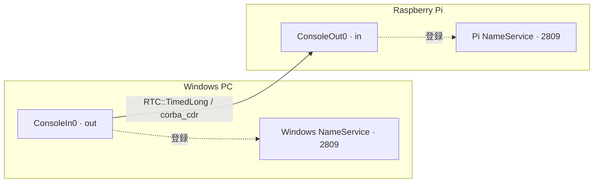

# Windows と Raspberry Pi に RTC を分散配置する手順

[English](en/windows-raspberry-pi.md)

Windows のコンソールに入力した整数を Raspberry Pi で受信します。OpenRTM-aist Python の SimpleIO サンプルを使い、別々のマシンで動く RTC を接続します。



## 1. 準備する

Windows の作業フォルダに RTC-Agent-Tools を配置します。Raspberry Pi OS を起動し、Pi の IP アドレス、SSH ユーザー名、SSH ホスト鍵のフィンガープリントを確認してください。エージェントが SSH で作業できるよう公開鍵を登録します。フィンガープリントは初回接続時に Pi 側で確認した値と照合し、パスワードや秘密鍵はチャットや設計情報に記載しないでください。

Windows と Pi の LAN アドレスで通信できるようにします。この例では TCP 2809 をネームサーバーに、TCP 2810 を RTC の CORBA エンドポイントに使います。Windows から Pi の SSH にも接続できる必要があります。両ホストのアドレスは起動時に確認してください。

## 2. 設計を依頼する

> RTC-Agent-Tools の AGENTS.md に沿って、Windows の ConsoleIn から Raspberry Pi の ConsoleOut に整数を送るシステムを設計して。Pi の IP は 172.31.222.98、SSH ユーザーは robot1-pi。

IP とユーザー名は実際の値に置き換えてください。RTSystemDesigner で Python 版の `ConsoleIn0.out → ConsoleOut0.in` とデータ型 `RTC::TimedLong` を確認します。エージェントは各 RTC の実行先を **Deployment → Host** に入力します。ノードを選択すると、同じ欄を確認・編集できます。この例では `ConsoleIn0` に `Windows PC`、`ConsoleOut0` に `Raspberry Pi` を設定します。接続に使う IP アドレスは後述の配備設定で指定します。Host が入力されたノードには図のカードにも値が表示されます。編集した場合はセッションを保存してから、設計完了をエージェントに伝えます。

> 設計完了。Windows に入力用の ConsoleIn ウィンドウを表示して起動して。

## 3. 配備と起動

ここはエージェントが実行します。Windows では利用可能な OpenRTM-aist Python と rtshell を使い、Pi には SSH で実行環境を準備します。今回の検証では、Pi の Raspberry Pi OS（Debian 13、ARM64）で omniORB と omniORBpy 4.3.4 をユーザー領域にビルドし、OpenRTM-aist Python 2.1.0 を専用の仮想環境に導入しました。

各マシンでネームサーバーを 1 つ起動または再利用し、自身の RTC を登録します。同じ PC の Windows と WSL2 は共有します。今回の設定値は以下のとおりです。

| RTC | `corba.nameservers` | `corba.endpoints` |
| --- | --- | --- |
| Windows の ConsoleIn0 | `172.31.222.246:2809` | `172.31.222.246:2810` |
| Pi の ConsoleOut0 | `172.31.222.98:2809` | `172.31.222.98:2810` |

登録を確認してから、エージェントが Windows で以下を実行します。

```powershell
rtcon -d -n windows-pi-demo -p dataport.interface_type=corba_cdr 172.31.222.246:2809/ConsoleIn0.rtc:out 172.31.222.98:2809/ConsoleOut0.rtc:in
rtact 172.31.222.98:2809/ConsoleOut0.rtc
rtact 172.31.222.246:2809/ConsoleIn0.rtc
```

## 4. 確認して終了する

RTSystemEditor のネームサービスビューに、この構成では `localhost:2809` と `172.31.222.98:2809` を追加します。Windows 側に `ConsoleIn0.rtc`、Pi 側に `ConsoleOut0.rtc` が表示されます。Windows の ConsoleIn に整数を入力し、エージェントに Pi 側の受信値を確認してもらいます。

> Raspberry Pi の ConsoleOut で、いま入力した整数を受信したか確認して。

今回の Pi では、エージェントが次のコマンドでログを確認できます。

```powershell
ssh robot1-pi@172.31.222.98 'tail -n 20 ~/rtc-agent-simpleio/logs/console-out.stdout.log'
```

> システムを終了して。

エージェントは両 RTC の終了と登録解除を確認します。今回のデモ専用に起動した Pi のネームサーバーも停止し、Windows の共有ネームサーバーは稼働を続けます。
